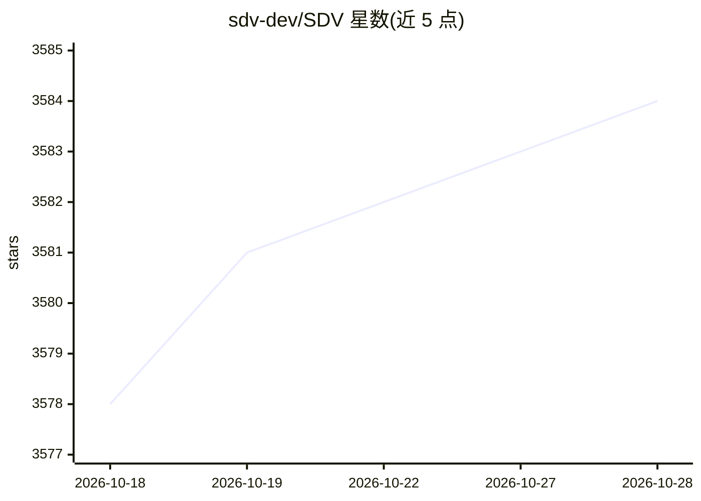

# sdv-dev/SDV

⭐ 3,584 · Python · NOASSERTION · 推送 2026-10-26 · [GitHub](https://github.com/sdv-dev/SDV) · [官网](https://docs.sdv.dev/sdv) · 组织维护

**生成表格合成数据的 Python 库：从真实数据学习并生成仿真数据**

Synthetic Data Vault（SDV）是 DataCebo 维护的 Python 库，用多种机器学习算法（GaussianCopula 统计方法到 CTGAN 深度学习方法）从真实表格数据学习模式并生成合成数据，支持单表、多表关联与序列数据。提供质量评估报告（0-100% 评分）、可视化对比、预处理、匿名化与业务约束定义。项目源于 MIT Data to AI Lab 2016 年论文，2020 年成立 DataCebo 公司持续维护，许可证为 Business Source License。

## 筛选速览

| 维度 | 判定 | 备注 |
|---|---|---|
| AI 角色 | `ai-native` | 本体是模型或模型工具 |
| 许可风险 | `none` | NOASSERTION |
| 部署形态 | `library` | 以包/库形式分发 |
| 模型依赖 | — | README 未给出锁定关系 |
| 硬件要求 | — | 无带数字的原话,不猜 |
| 安装摩擦 | `low` | 无编译、无系统依赖或容器化 |
| 成熟度 | — | 结构信号不足 |

## 能力要点

- 多种合成模型：GaussianCopula 统计方法到 CTGAN 深度学习方法
- 支持单表、多表关联与序列数据合成
- 质量报告按 0-100% 评分并可视化对比真实与合成数据
- 匿名化敏感列并保持键与统计关系完整

## 适用场景

- 为测试或开发环境生成不含真实敏感信息的仿真数据
- 对合成数据与真实数据做质量与隐私评估
- 给多表关联数据库生成保持外键关系的数据

## 场景标签

 · 领域:数据科学/合成数据生成

## 证据(README 行号)

> L18: The **Synthetic Data Vault** (SDV) is a Python library designed to be your one-stop shop for
> L23: :brain: **Create synthetic data using machine learning.** The SDV offers multiple models, ranging
> L24: from classical statistical methods (GaussianCopula) to deep learning methods (CTGAN). Generate

## 星数曲线

2026-10-18 3,578 → 2026-10-28 3,584（+6）

---
*卡片 v1 · prompt 1.4 · 生成 2026-10-20 · 置信度 high · 依据 README sha `9949908ae638` · [字段定义](../../DATASET.md)*
