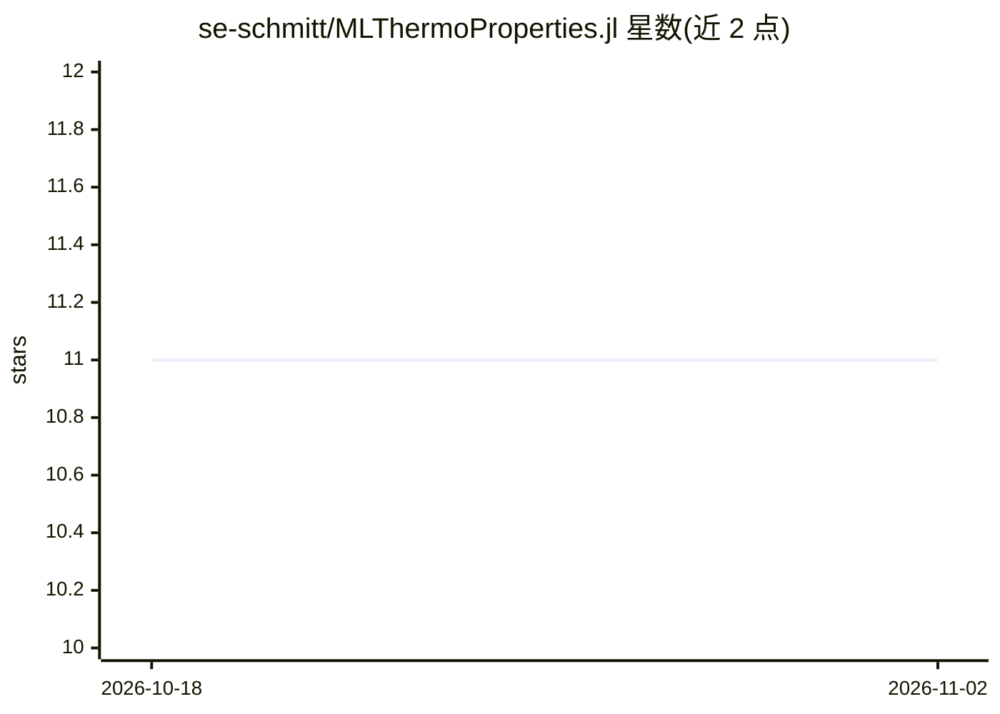

# se-schmitt/MLThermoProperties.jl

⭐ 11 · Julia · MIT · 推送 2026-11-01 · [GitHub](https://github.com/se-schmitt/MLThermoProperties.jl) · 个人维护

**Julia 混合 ML 热力学性质预测模型库（集成 Clapeyron.jl）**

提供用于热力学性质预测的混合机器学习模型的 Julia 实现，以 Clapeyron.jl 作为热力学求解库集成。示例覆盖用 HANNA/GRAPPA 计算乙醇-苯体系的泡点（VLE），以及用 ESE 计算无限稀释扩散系数；文档另含 p-x-y 相图与温度扫描等完整工作流。包含可独立使用的子包 ChemBERTa.jl，为 MLPROP 模型提供基于 SMILES 字符串生成分子嵌入的 ChemBERTa-77M-MTR 编码器。配套论文在准备中，另有 MLPROP 交互式网站。

## 筛选速览

| 维度 | 判定 | 备注 |
|---|---|---|
| AI 角色 | `ai-native` | 本体是模型或模型工具 |
| 许可风险 | `permissive` | MIT |
| 部署形态 | `None` |  |
| 模型依赖 | — | README 未给出锁定关系 |
| 硬件要求 | — | 无带数字的原话,不猜 |
| 安装摩擦 | `low` | 无编译、无系统依赖或容器化 |
| 成熟度 | — | 结构信号不足 |

## 能力要点

- HANNA、GRAPPA、ESE 等混合 ML 热力学模型实现
- 与 Clapeyron.jl 热力学求解库集成
- 独立子包 ChemBERTa.jl：SMILES 生成分子嵌入
- 支持 VLE 泡点、无限稀释扩散系数等计算示例

## 适用场景

- 化工流程模拟中预测混合物的活度系数与蒸气压
- 计算无限稀释条件下的扩散系数
- 从 SMILES 字符串生成分子嵌入用于 MLPROP 模型

## 场景标签

 · 领域:化学工程/热力学计算

## 证据(README 行号)

> L3: This repository contains Julia implementations of hybrid ML models for thermodynamic property prediction integrated 
> L11: - **VLE calculation with HANNA and GRAPPA**: compute the bubble point of the equimolar mixture ethanol + benzene at

## 星数曲线

2026-10-18 11 → 2026-11-02 11（+0）

---
*卡片 v1 · prompt 1.4 · 生成 2026-11-01 · 置信度 high · 依据 README sha `da1f1493c902` · [字段定义](../../DATASET.md)*
