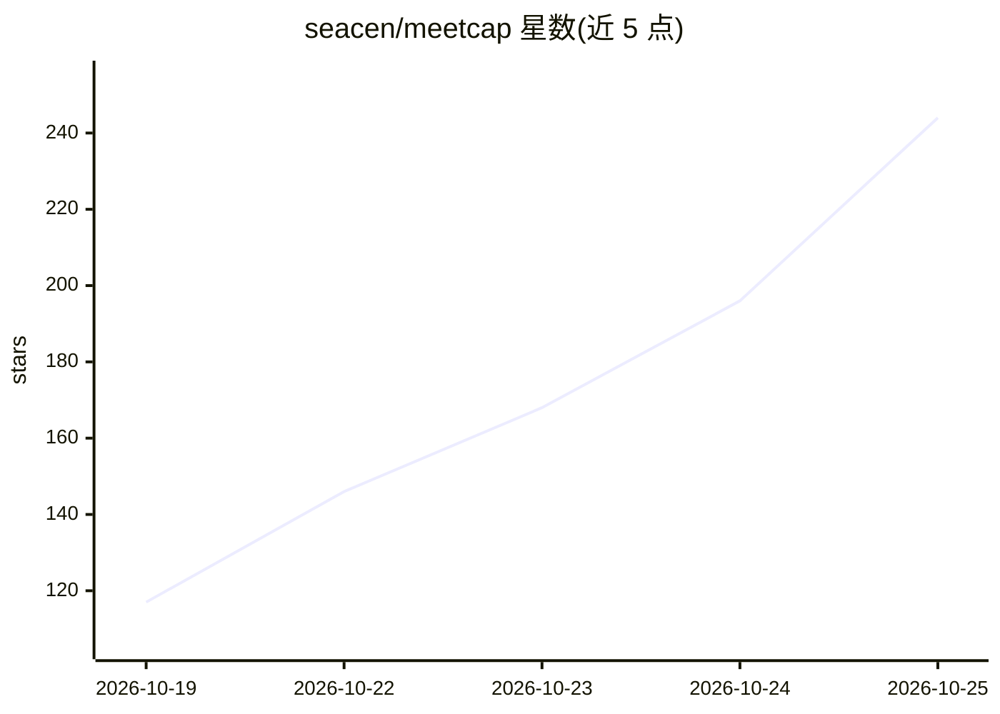

# seacen/meetcap

⭐ 244 · Shell · NOASSERTION · 推送 2026-10-24 · [GitHub](https://github.com/seacen/meetcap) · [官网](https://meetcap.seacen.dev) · 个人维护 · 中文 README

**Mac 端本地转录会议并生成纪要的会议助手**

macOS 桌面应用：录制任意会议（应用/浏览器标签/会议室/已有录音），在本机完成转录与说话人分离，音频不上传；会议中每隔数分钟生成解释生僻术语的实时摘要，结束后生成英文/中文纪要并导出 Word 或 PDF。纪要撰写可接入本机 agent（含 Claude Code、Codex 等 20+ 种）、自有 API key（Claude API 或任意 OpenAI 兼容服务）或自动下载的本地模型。记录以 Markdown 文件形式存储于用户目录，可放入 Obsidian vault。免费、无账号；非开源，仓库仅承载发布物与 agent skill。Windows 与 iPhone 版本开发中。

## 筛选速览

| 维度 | 判定 | 备注 |
|---|---|---|
| AI 角色 | `ai-native` | 本体是模型或模型工具 |
| 许可风险 | `none` | NOASSERTION |
| 部署形态 | `None` |  |
| 模型依赖 | locked-api |  |
| 硬件要求 | — | 无带数字的原话,不猜 |
| 安装摩擦 | `low` | 无编译、无系统依赖或容器化 |
| 成熟度 | — | 结构信号不足 |

## 能力要点

- 录音在本机转录，音频不上传；纪要仅传文本给所选 AI
- 纪要要点可链接回原句并点击回放，疑似误听处有标记
- 说话人分离与词表学习：确认一次姓名后后续会议自动识别
- 支持 agent（Claude Code/Codex 等）、自有 API key、本地模型三种纪要生成方式

## 适用场景

- 连续开会时自动录制并在结束后拿到可转发的会议纪要
- 中文英文混说的会议需要准确转录与双语纪要
- 涉密会议要求录音与文本都不离开本机
- 让我已有的 AI agent 检索过去的会议记录

## 场景标签

`语音识别` `AI 助手` · 领域:对话与助手

## 证据(README 行号)

> L20: Record any meeting you want, free, for as long as you like. If your mind drifts or the topic is new, live summaries
> L72: - **From your agent.** Tell your agent "record this one" and it does. Mid-meeting, ask what you missed. Afterward, 
> L75: - **A local model.** MeetCap downloads and sets up a model on your computer. It writes summaries and minutes right 

## 星数曲线

2026-10-19 117 → 2026-10-25 244（+127）

---
*卡片 v1 · prompt 1.4 · 生成 2026-10-22 · 置信度 high · 依据 README sha `50590d70d93b` · [字段定义](../../DATASET.md)*
