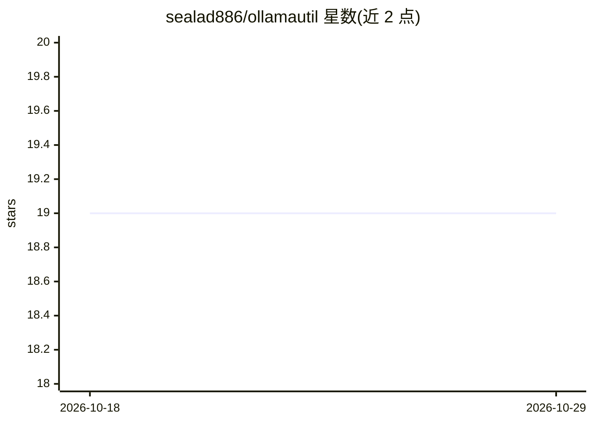

# sealad886/ollamautil

⭐ 19 · Python · GPL-3.0 · 推送 2026-10-10 · [GitHub](https://github.com/sealad886/ollamautil) · 个人维护

**管理 Ollama 模型缓存的 CLI 工具：内外置存储间迁移模型**

面向使用 Ollama 的开发者的命令行工具：列出已装模型及其所在缓存位置，通过符号链接在内置/外置模型缓存目录间切换，支持带 SHA-256 校验、进度条与元数据保留的模型迁移，可从内外缓存删除模型，也可从 Ollama.com 拉取模型或推送模型到个人仓库。通过环境变量配置缓存路径，提供交互式菜单与 doctor/list/toggle 等子命令，以 pip 从 PyPI 安装，GPL-3.0 许可。

## 筛选速览

| 维度 | 判定 | 备注 |
|---|---|---|
| AI 角色 | `ai-ecosystem` | LLM/agent 周边工具 |
| 许可风险 | `viral` | GPL-3.0 |
| 部署形态 | `library` | 以包/库形式分发 |
| 模型依赖 | local-ok | 支持本地模型 |
| 硬件要求 | — | 无带数字的原话,不猜 |
| 安装摩擦 | `low` | 无编译、无系统依赖或容器化 |
| 成熟度 | — | 结构信号不足 |

## 能力要点

- 内置/外置缓存间用符号链接原子切换
- 模型迁移带 SHA-256 校验与进度条
- 支持从 Ollama.com 拉取与推送（仅个人仓库）到个人仓库
- 交互式菜单与 doctor/list/toggle 子命令

## 适用场景

- 磁盘空间不足时把 Ollama 模型迁到外置存储
- 在多块存储间切换活跃的 Ollama 缓存目录
- 清理不再需要的模型文件

## 场景标签

 · 领域:LLM 基础设施/本地模型管理

## 证据(README 行号)

> L3: A command-line utility to manage the Ollama cache, making it easier to maintain and move Ollama models between diffe
> L8: - Toggle between internal and external Ollama cache directories using symbolic links

## 星数曲线

2026-10-18 19 → 2026-10-29 19（+0）

---
*卡片 v1 · prompt 1.4 · 生成 2026-10-28 · 置信度 high · 依据 README sha `d78a27029504` · [字段定义](../../DATASET.md)*
