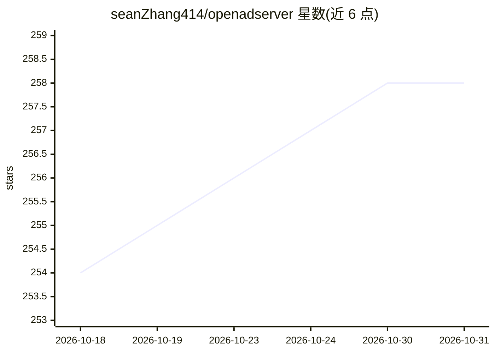

# seanZhang414/openadserver

⭐ 258 · Python · NOASSERTION · 推送 2025-12-21 · [GitHub](https://github.com/seanZhang414/openadserver) · [官网](https://github.com/seanZhang414/openadserver) · 个人维护

**自托管开源广告投放平台，内置 ML CTR 预估**

面向中小企业、开发者与科研者的自托管广告服务器：提供广告请求 API（Banner/原生/视频/插屏）、地理/设备/人群定向、频次控制、预算平滑、eCPM 排序（CPM/CPC/CPA/oCPM）与事件追踪。ML 部分为 CTR 预估（DeepFM/FM/LR，<5ms 推理、模型热更新），可从 Criteo 数据训练自定义模型。技术栈 Python/FastAPI/PyTorch，依赖 PostgreSQL 与 Redis，Docker Compose 一键部署。当前无管理 UI，OpenRTB、Header Bidding 等在路线图中未实现。

## 筛选速览

| 维度 | 判定 | 备注 |
|---|---|---|
| AI 角色 | `ai-enhanced` | 去掉 AI 部分产品仍成立 |
| 许可风险 | `none` | NOASSERTION |
| 部署形态 | `self-host` | docker 或自建部署 |
| 模型依赖 | — | README 未给出锁定关系 |
| 硬件要求 | — | 无带数字的原话,不猜 |
| 安装摩擦 | `low` | 无编译、无系统依赖或容器化 |
| 成熟度 | — | 结构信号不足 |

## 能力要点

- DeepFM/FM/LR 三种 CTR 预估模型，支持模型热更新与自定义训练（Criteo 数据集）
- 广告请求 → 检索 → 过滤 → 预估 → 排序全流水线，P99 <10ms
- 定向、频次控制、预算平滑与 eCPM 排序，支持 CPM/CPC/CPA/oCPM
- Prometheus 指标与 Grafana 集成，Docker Compose 部署

## 适用场景

- 搭建自有广告网络，替代 Google Ad Manager 等托管平台
- 游戏公司或应用开发者做内部广告与直客投放
- 电商平台的赞助位竞价展示
- 研究计算广告学与 CTR 预估系统实现

## 场景标签

 · 领域:广告技术/计算广告

## 证据(README 行号)

> L60: - **CTR Prediction Models** — DeepFM, Logistic Regression, FM
> L222: python scripts/criteo/stress_test.py --campaigns 10 --requests 100 --no-ml

## 星数曲线

2026-10-18 254 → 2026-10-31 258（+4）

---
*卡片 v1 · prompt 1.4 · 生成 2026-10-22 · 置信度 mid · 依据 README sha `660cb9b01ed4` · [字段定义](../../DATASET.md)*
