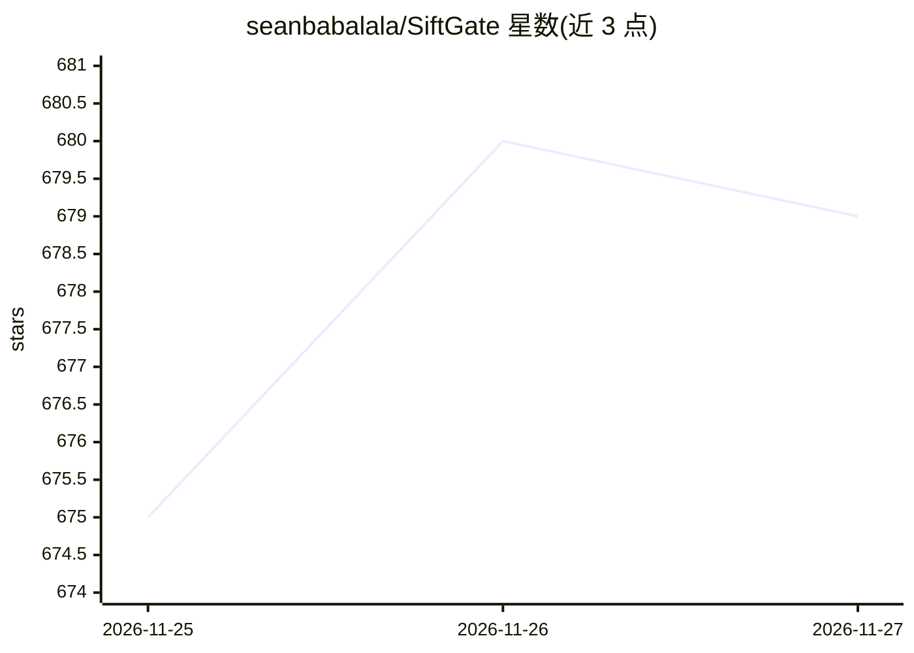

# seanbabalala/SiftGate

⭐ 679 · TypeScript · MIT · 推送 2026-11-23 · [GitHub](https://github.com/seanbabalala/SiftGate) · [官网](https://github.com/seanbabalala/SiftGate/blob/main/docs/enterprise-overview.md) · 个人维护 · 中文 README

**自托管企业 AI 网关：密钥、策略、审计与路由集中管控**

运行在企业自有基础设施上的 MIT 许可 AI 网关：业务应用、编码代理（Claude Code、Codex、Cursor 等）、SDK 与 MCP 工具经由网关而非直连 AI 提供商。提供 OpenAI/Anthropic 兼容端点，管理范围化 API 密钥、策略命名空间、多级预算与费用分摊导出、缓存感知凭据池、故障转移链与断路器。默认仅存储元数据，不存提示词与响应；管理操作写入哈希链审计日志。从源码或 Docker 安装，PoC 用 SQLite，生产可迁移至 PostgreSQL、Redis、Kubernetes 或 Helm。

## 筛选速览

| 维度 | 判定 | 备注 |
|---|---|---|
| AI 角色 | `ai-ecosystem` | LLM/agent 周边工具 |
| 许可风险 | `permissive` | MIT |
| 部署形态 | `self-host` | docker 或自建部署 |
| 模型依赖 | — | README 未给出锁定关系 |
| 硬件要求 | — | 无带数字的原话,不猜 |
| 安装摩擦 | `low` | 无编译、无系统依赖或容器化 |
| 成熟度 | — | 结构信号不足 |

## 能力要点

- 范围化网关 API 密钥与策略命名空间，空交集 fail-closed
- 默认元数据审计，不存储提示词与响应内容
- 多级预算、价格簿与费用分摊 CSV/JSON 导出
- 缓存感知凭据池、fallback 链、断路器与 Route Explanation

## 适用场景

- 企业集中管理多个团队的 AI 调用密钥与访问策略
- 为编码代理签发范围化密钥并按团队预算限额计费
- 单一提供商故障时自动切换备用凭据与节点
- 向安全审查方出示不含内容的隐私姿态与审计证据

## 场景标签

`模型网关` · 领域:Agent 开发

## 证据(README 行号)

> L39: SiftGate is an MIT-licensed AI gateway that you run on your own
> L41: Cursor, SDKs and MCP tools send requests to SiftGate instead of calling AI
> L60: **1. Access and policy.** One ingress for OpenAI- and Anthropic-compatible

## 星数曲线

2026-11-25 675 → 2026-11-27 679（+4）

---
*卡片 v1 · prompt 1.4 · 生成 2026-11-24 · 置信度 high · 依据 README sha `da1dfbe25d29` · [字段定义](../../DATASET.md)*
