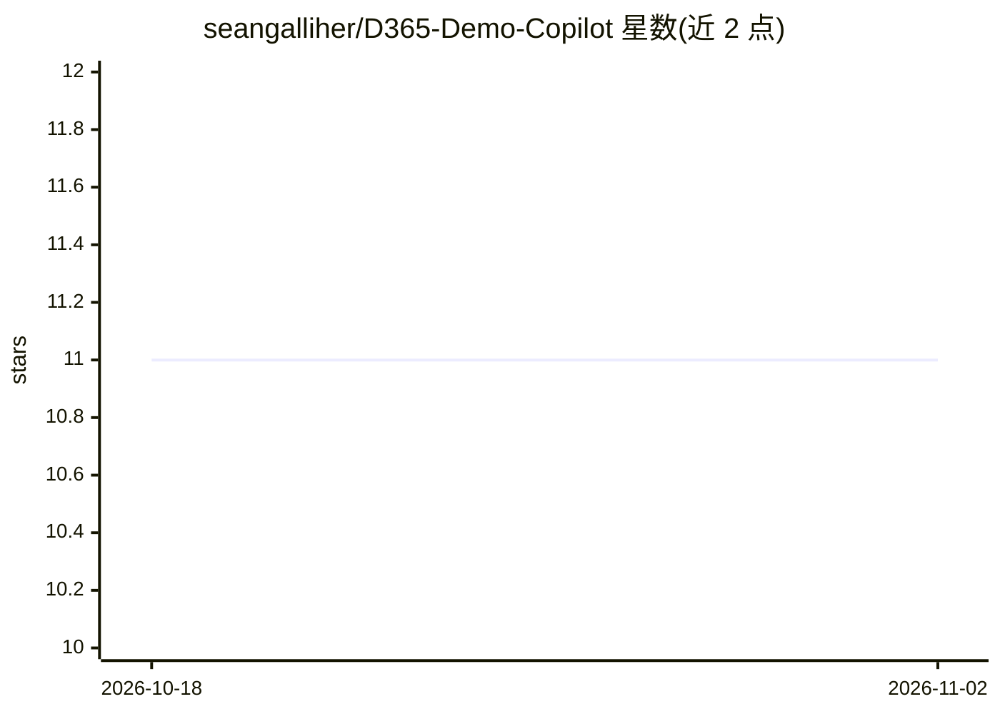

# seangalliher/D365-Demo-Copilot

⭐ 11 · Python · MIT · 推送 2026-03-26 · [GitHub](https://github.com/seangalliher/D365-Demo-Copilot) · 个人维护

**面向 Dynamics 365 的 AI 现场演示代理：自动规划并执行交互演示**

以自然语言接收演示需求，由 LLM 生成结构化演示计划，并通过 Playwright 控制的浏览器在 Dynamics 365 环境中逐步执行：视觉聚光灯、字幕覆盖层、业务价值卡片、TTS 语音解说与进度控制，交互通过注入的 sidecar 聊天面板完成。LLM 支持 Azure OpenAI、GitHub Models（GitHub PAT）或 OpenAI API key 三种接入；可连接 Dataverse MCP 获取实体 schema，并集成 MS Learn 文档；演示结束后可导出带截图的 PDF 脚本。

## 筛选速览

| 维度 | 判定 | 备注 |
|---|---|---|
| AI 角色 | `ai-native` | 本体是模型或模型工具 |
| 许可风险 | `permissive` | MIT |
| 部署形态 | `None` |  |
| 模型依赖 | locked-api |  |
| 硬件要求 | — | 无带数字的原话,不猜 |
| 安装摩擦 | `low` | 无编译、无系统依赖或容器化 |
| 成熟度 | — | 结构信号不足 |

## 能力要点

- 自然语言生成结构化演示计划并在浏览器中自动执行
- 视觉聚光灯、字幕覆盖、业务价值卡片等演示呈现层
- TTS 语音解说支持 Azure/OpenAI/浏览器原生三种引擎
- 演示后自动导出带截图的 PDF 脚本

## 适用场景

- 售前或顾问用自然语言驱动 Dynamics 365 现场演示
- 生成带视觉强调与解说的标准化产品演示流程
- 演示结束后留存可复用的 PDF 演示脚本

## 场景标签

`浏览器自动化` · 领域:效率与自动化

## 证据(README 行号)

> L8: The D365 Demo Copilot takes customer requests in natural language, generates structured demo plans, and executes the
> L18: |**Dynamic Demo Planning**|Describe what you want to demo and the AI generates a structured plan with sections and 

## 星数曲线

2026-10-18 11 → 2026-11-02 11（+0）

---
*卡片 v1 · prompt 1.4 · 生成 2026-11-01 · 置信度 high · 依据 README sha `df6e388e21ac` · [字段定义](../../DATASET.md)*
