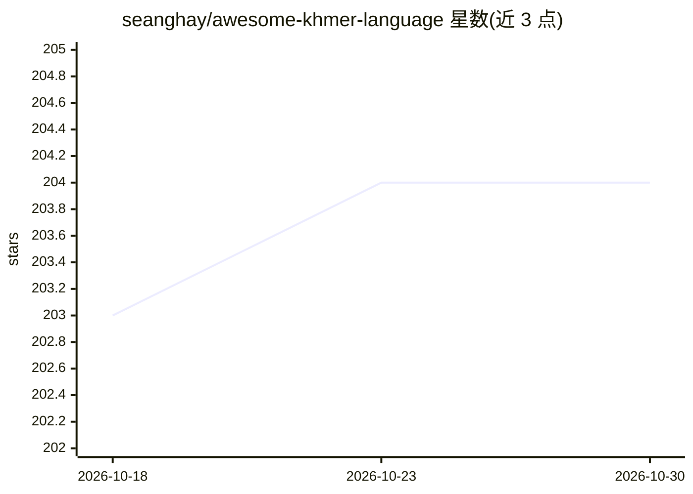

# seanghay/awesome-khmer-language

⭐ 204 · Python · 推送 2026-07-03 · [GitHub](https://github.com/seanghay/awesome-khmer-language) · 个人维护

**高棉语语言资源汇总清单：工具、数据集、论文与模型**

面向高棉语（柬埔寨语言）研究与开发的资源策展清单，按 9 个板块组织：Unicode 规范、工具包（分词、拼写检查、OCR、G2P、强制对齐等）、数据集（语料、语音、ASR 数据）、研究论文（OCR、分词、ASR、机器翻译）、项目与模型（基于 Qwen3-ASR、XLM-RoBERTa、Whisper、wav2vec2 等微调的高棉语模型）、博客/幻灯片、通用工具、文本排版引擎与活跃研究者名录。由个人维护，通过 Pull Request 收录条目。

## 筛选速览

| 维度 | 判定 | 备注 |
|---|---|---|
| AI 角色 | `ai-knowledge` | 知识聚合/清单类 |
| 许可风险 | `none` | — |
| 部署形态 | `library` | 以包/库形式分发 |
| 模型依赖 | — | README 未给出锁定关系 |
| 硬件要求 | — | 无带数字的原话,不猜 |
| 安装摩擦 | `medium` | 含编译或系统依赖之一 |
| 成熟度 | — | 结构信号不足 |

## 能力要点

- 9 个板块覆盖规范、工具、数据集、论文、模型与研究者
- 收录高棉语专用模型（ASR/OCR/分词/XLM-RoBERTa/TTS）
- 收录 khmer-ocr-benchmark-dataset 等基准数据集

## 适用场景

- 寻找高棉语 NLP 的分词、OCR、ASR 工具与数据集
- 调研高棉语相关研究论文与预训练模型
- 联系高棉语语言技术领域的研究者

## 场景标签

`精选清单` · 领域:学习与行业

## 证据(README 行号)

> L3: A large collection of Khmer language resources. Khmer is a language used by Cambodia.
> L62: ### 3. Datasets
> L88: ### 4. Research Papers
> L120: ### 5. Projects/Models

## 星数曲线

2026-10-18 203 → 2026-10-30 204（+1）

---
*卡片 v1 · prompt 1.4 · 生成 2026-10-22 · 置信度 mid · 依据 README sha `58cef2789967` · [字段定义](../../DATASET.md)*
