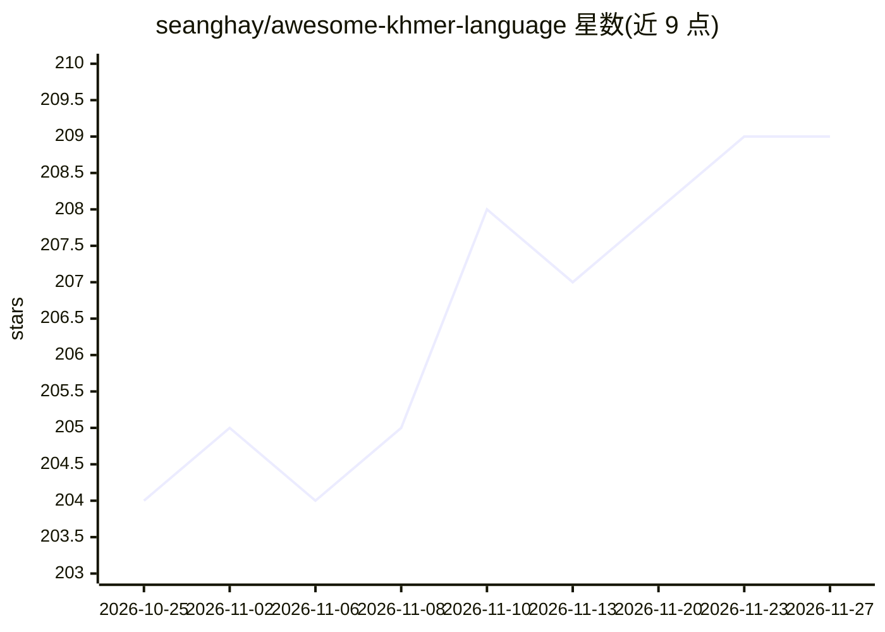

# seanghay/awesome-khmer-language

⭐ 209 · Python · 推送 2026-11-09 · [GitHub](https://github.com/seanghay/awesome-khmer-language) · 个人维护

**高棉语 NLP 资源清单：工具、数据集、论文与模型导航**

面向高棉语（柬埔寨官方语言）处理的开源资源聚合清单，按规范、工具包、数据集、研究论文、项目/模型五类组织。覆盖分词、G2P、语音语料、OCR 数据、预训练模型（XLM-RoBERTa、ALBERT、wav2vec2 微调）等条目，多由柬埔寨本地开发者与研究团队维护，含作者本人的多个语音语料与分词工具仓库。清单由 KhmerScan 赞助，接受 Pull Request。

## 筛选速览

| 维度 | 判定 | 备注 |
|---|---|---|
| AI 角色 | `ai-knowledge` | 知识聚合/清单类 |
| 许可风险 | `none` | — |
| 部署形态 | `library` | 以包/库形式分发 |
| 模型依赖 | — | README 未给出锁定关系 |
| 硬件要求 | — | 无带数字的原话,不猜 |
| 安装摩擦 | `medium` | 含编译或系统依赖之一 |
| 成熟度 | — | 结构信号不足 |

## 能力要点

- 按规范/工具/数据集/论文/模型五类组织的资源索引
- 含多个高棉语语音语料与 OCR 基准数据集
- 收录分词、拼写检查、强制对齐、TTS 等任务工具
- 包括 Qwen3-ASR 与 wav2vec2 微调的高棉语模型

## 适用场景

- 查找高棉语分词或 G2P 工具
- 寻找高棉语语音识别训练数据
- 调研高棉语低资源 NLP 研究进展

## 场景标签

`精选清单` · 领域:学习与行业

## 证据(README 行号)

> L3: A large collection of Khmer language resources. Khmer is a language used by Cambodia.
> L20: ### 2. Toolkit
> L66: ### 3. Datasets

## 星数曲线

2026-10-25 204 → 2026-11-27 209（+5）

---
*卡片 v1 · prompt 1.4 · 生成 2026-11-25 · 置信度 mid · 依据 README sha `d6ab628ccc8d` · [字段定义](../../DATASET.md)*
