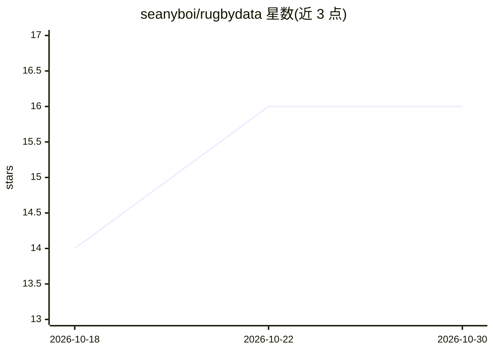

# seanyboi/rugbydata

⭐ 16 · Apache-2.0 · 推送 2026-10-04 · [GitHub](https://github.com/seanyboi/rugbydata) · 个人维护

**为 rugbypy 包提供每日更新的橄榄球数据仓库**

存储 rugbypy Python 包所需的橄榄球数据的数据仓库，数据每日更新。README 仅说明本仓库包含 rugbypy 包运行所需的全部数据，属于包的配套数据层。主题标签涉及数据科学、机器学习、体育分析等领域，但 README 正文未描述具体分析功能或数据结构，也未提供独立的安装运行说明。

## 筛选速览

| 维度 | 判定 | 备注 |
|---|---|---|
| AI 角色 | `ai-knowledge` | 知识聚合/清单类 |
| 许可风险 | `permissive` | Apache-2.0 |
| 部署形态 | `None` |  |
| 模型依赖 | — | README 未给出锁定关系 |
| 硬件要求 | — | 无带数字的原话,不猜 |
| 安装摩擦 | `low` | 无编译、无系统依赖或容器化 |
| 成熟度 | — | 结构信号不足 |

## 能力要点

- 为 rugbypy 包提供所需数据
- 数据每日更新

## 适用场景

- 为 rugbypy 包获取橄榄球数据
- 了解 rugbypy 依赖的数据来源

## 场景标签

 · 领域:体育数据

## 证据(README 行号)

> L3: This repo contains all the data required for the rugbypy package.

## 星数曲线

2026-10-18 14 → 2026-10-30 16（+2）

---
*卡片 v1 · prompt 1.4 · 生成 2026-10-30 · 置信度 low · 依据 README sha `1cbc12817297` · [字段定义](../../DATASET.md)*
