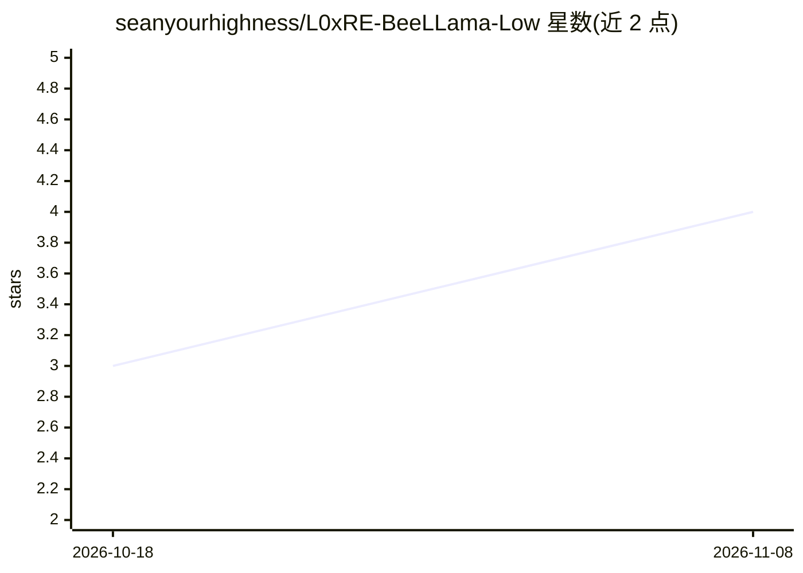

# seanyourhighness/L0xRE-BeeLLama-Low

⭐ 18 · Cuda · 推送 2026-11-23 · [GitHub](https://github.com/seanyourhighness/L0xRE-BeeLLama-Low) · [官网](https://github.com/seanyourhighness/L0xRE-BeeLLama-Low/releases/latest) · 个人维护

**面向 RTX 30/40/50 显卡用户的本地 LLM 运行时与模型包**

L0xRE 是一个在 Linux 与 Windows 上运行的本地推理运行时，捆绑 27B 量化模型（GGUF/llama.cpp 生态），面向持有 NVIDIA RTX 30/40/50 系列 12 GB 以上显存 GPU 的用户。提供 OpenAI 兼容 API（127.0.0.1:8080/v1），支持 256K 上下文、按需视觉加载、低显存模式与推测解码，附带内嵌 WebUI。通过 curl 下载脚本安装，约 20 GB 磁盘空间，提供 update 脚本回滚机制。

## 筛选速览

| 维度 | 判定 | 备注 |
|---|---|---|
| AI 角色 | `ai-ecosystem` | LLM/agent 周边工具 |
| 许可风险 | `none` | — |
| 部署形态 | `desktop` | 安装包/桌面程序 |
| 模型依赖 | — | README 未给出锁定关系 |
| 硬件要求 | `gpu-8g` | |
| 安装摩擦 | `medium` | 含编译或系统依赖之一 |
| 成熟度 | — | 结构信号不足 |

## 能力要点

- 在 127.0.0.1:8080/v1 提供 OpenAI 兼容 API，可接入任意 agent
- 默认模型 L0xRE-V2-27b-Low，支持 256K 上下文与按需视觉（--no-mmproj-offload）
- 12 GB 显卡提供低显存启动脚本（start-12gb-lowvram.ps1/-LowVram）
- README 给出 RTX 3060/4090/5090 在 Linux/Windows/WSL2 下的解码与预填充基准

## 适用场景

- 在单张 RTX 3060 12 GB 显卡上本地运行 27B 模型
- 把本地 OpenAI 兼容端点接入 coding agent 工具
- Windows/Linux 下通过安装脚本一键部署并更新

## 场景标签

`推理引擎` · 领域:训练与推理

## 证据(README 行号)

> L94: **Use it.** L0xRE serves an OpenAI-compatible API at **`http://127.0.0.1:8080/v1`** with the model name **`L0xRE-27
> L75: You need an NVIDIA GPU with 12 GB or more (RTX 30, 40 or 50 series), a recent NVIDIA driver and about 20 GB of free

## 星数曲线

2026-10-18 3 → 2026-11-08 4（+1）

---
*卡片 v1 · prompt 1.4 · 生成 2026-11-24 · 置信度 high · 依据 README sha `f790f275fb22` · [字段定义](../../DATASET.md)*
