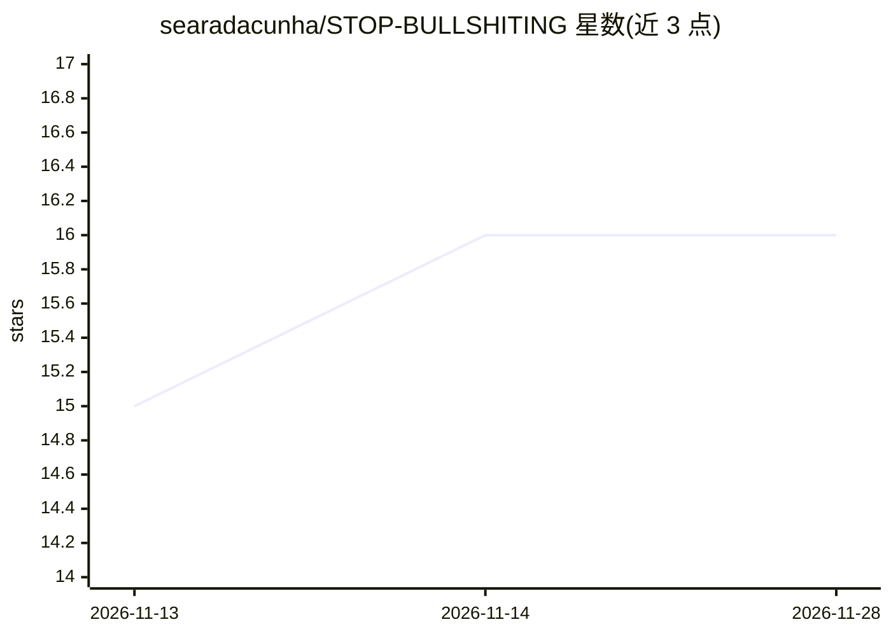

# searadacunha/STOP-BULLSHITING

⭐ 16 · Python · MIT · 推送 2026-11-22 · [GitHub](https://github.com/searadacunha/STOP-BULLSHITING) · 个人维护

**压缩编码代理终端输出的本地 CLI，保留可恢复原文**

面向使用 Claude Code / Codex 等编码代理的开发者的 Python CLI：把冗长的日志、JSON 与文本输出替换为有界的、可检视的预览，完整原文存于本地磁盘并可通过回执 ID 随时恢复。识别 git/pytest/jest/rg 等命令的输出结构，剔除通过行、重复路径等内容；提供本地 MCP 服务器、代码导航（Python/JS/TS 符号与引用）、SQLite 持久笔记与用量统计。核心运行时无第三方 Python 依赖，集成均为 opt-in 的 hook 适配器，README 明确声明不保证降低账单，仅度量字符缩减。

## 筛选速览

| 维度 | 判定 | 备注 |
|---|---|---|
| AI 角色 | `ai-ecosystem` | LLM/agent 周边工具 |
| 许可风险 | `permissive` | MIT |
| 部署形态 | `library` | 以包/库形式分发 |
| 模型依赖 | — | README 未给出锁定关系 |
| 硬件要求 | — | 无带数字的原话,不猜 |
| 安装摩擦 | `low` | 无编译、无系统依赖或容器化 |
| 成熟度 | — | 结构信号不足 |

## 能力要点

- 长输出替换为有界预览，原文本地存储、凭回执 ID 完整恢复
- 命令感知视图：识别 git/pytest/jest/go/cargo/rg 等输出结构并保留诊断与匹配行
- 本地 MCP 服务器：回执搜索、符号、引用、仓库地图、可逆压缩
- 核心运行时零第三方 Python 依赖，Claude/Codex hook 集成为 opt-in 且可逆

## 适用场景

- 让编码代理读取大日志和长命令输出时少占用上下文窗口
- 事后按行号或搜索词恢复被压缩的完整原文
- 检索最近命令输出的精确片段而不重读全部内容

## 场景标签

 · 领域:开发者工具/LLM 上下文管理

## 证据(README 行号)

> L18: Coding agents read huge logs, repetitive terminal output, massive JSON objects, code they never needed, and the sam
> L36: |**Agent hook adapters**|Opt-in Claude `PostToolUse` (Bash, Grep) and Codex `PreToolUse` adapters, tested against t

## 星数曲线

2026-11-13 15 → 2026-11-28 16（+1）

---
*卡片 v1 · prompt 1.4 · 生成 2026-11-18 · 置信度 mid · 依据 README sha `bb69d190756d` · [字段定义](../../DATASET.md)*
