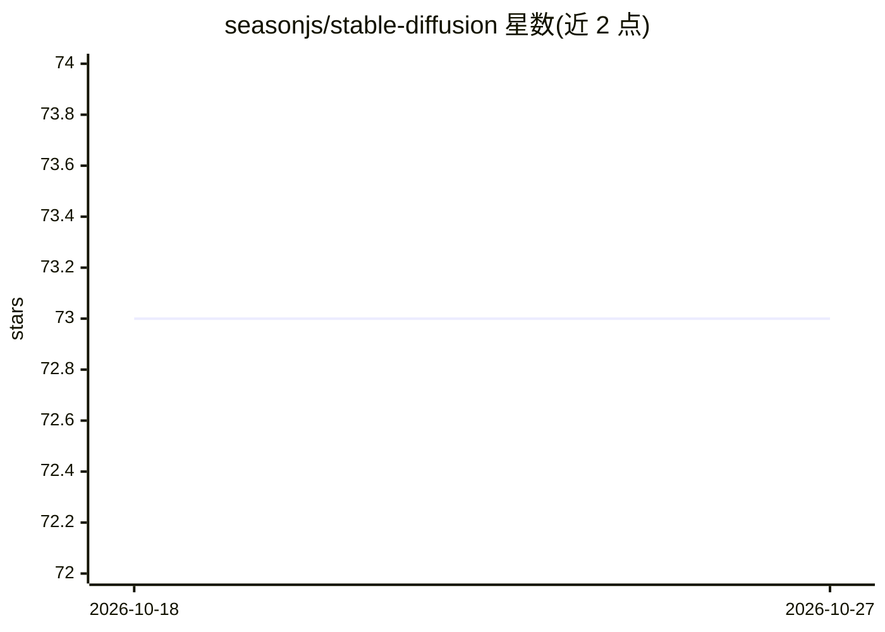

# seasonjs/stable-diffusion

⭐ 73 · Go · MIT · 推送 2026-06-08 · [GitHub](https://github.com/seasonjs/stable-diffusion) · [官网](https://pkg.go.dev/github.com/seasonjs/stable-diffusion) · 个人维护

**纯 Go 封装 stable-diffusion.cpp，跨平台文生图/图生图推理**

sd.go 是 stable-diffusion.cpp（基于 ggml）的纯 Go（无 cgo）封装库，通过 Predict 与 ImagePredict 两个 API 提供文本生成图像与图像生成图像能力；NewAutoModel 自动加载动态库。预编译动态库来自 stable-diffusion.cpp-build release，支持 Windows x64（CUDA12/ROCm5.5）、Linux x64、macOS x64/arm；也可自行构建或使用低级 API。面向希望在 Go 程序中集成 stable-diffusion 推理的开发者，发布程序需附带动态库与模型文件。

## 筛选速览

| 维度 | 判定 | 备注 |
|---|---|---|
| AI 角色 | `ai-native` | 本体是模型或模型工具 |
| 许可风险 | `permissive` | MIT |
| 部署形态 | `None` |  |
| 模型依赖 | — | README 未给出锁定关系 |
| 硬件要求 | — | 无带数字的原话,不猜 |
| 安装摩擦 | `medium` | 含编译或系统依赖之一 |
| 成熟度 | — | 结构信号不足 |

## 能力要点

- 纯 Go、无 cgo 封装，提供 Predict / ImagePredict API
- 预编译动态库自动加载（NewAutoModel），支持校验 MD5
- 跨平台：Windows CUDA12/ROCm5.5、Linux x64、macOS x64/arm
- 提供与 stable-diffusion-cpp 一致的低级 API

## 适用场景

- 在 Go 服务中集成文生图/图生图推理
- 跨平台分发内置 stable-diffusion 的 Go 程序
- 需要无 cgo 依赖构建 Stable Diffusion 应用

## 场景标签

`图像生成` `推理引擎` · 领域:内容生成

## 证据(README 行号)

> L7: sd.go is a wrapper around stable-diffusion.cpp, which is an adaption
> L44: This `stable-diffusion` golang library provide two api `Predict` and `ImagePredict`.

## 星数曲线

2026-10-18 73 → 2026-10-27 73（+0）

---
*卡片 v1 · prompt 1.4 · 生成 2026-10-24 · 置信度 high · 依据 README sha `ef2df88a0cec` · [字段定义](../../DATASET.md)*
