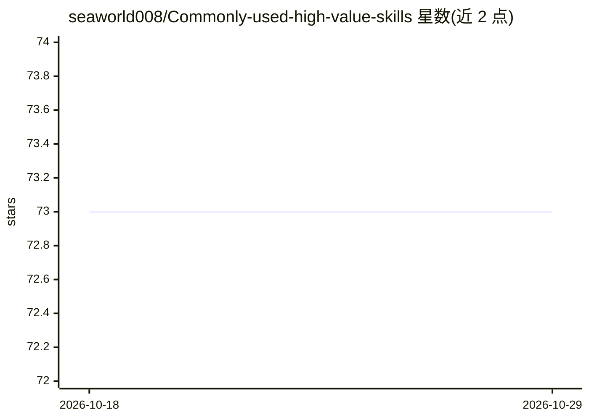

# seaworld008/Commonly-used-high-value-skills

⭐ 73 · Python · MIT · 推送 2026-10-27 · [GitHub](https://github.com/seaworld008/Commonly-used-high-value-skills) · 个人维护 · 中文 README

**面向 AI 开发者的多客户端 Agent Skills 技能库（16 类 294 个）**

收录 294 个 SKILL.md 格式技能，按开发工程、AI 工作流、DevOps、金融投资、办公文档等 16 个分类组织，多数技能附带 scripts/、references/、assets/ 可复用内容。兼容 Codex、Claude Code、Hermes Agent、OpenClaw 等消费端：Codex/Claude Code 通过同步脚本安装到本机技能目录，OpenClaw 使用脚本导出的扁平目录，源码浏览型工具直接读取 skills/。仓库提供 npx 一键安装器、许可证审计、死链巡检等维护脚本，内置 skill-vetter 等安全审查类技能。

## 筛选速览

| 维度 | 判定 | 备注 |
|---|---|---|
| AI 角色 | `ai-knowledge` | 知识聚合/清单类 |
| 许可风险 | `permissive` | MIT |
| 部署形态 | `self-host` | docker 或自建部署 |
| 模型依赖 | — | README 未给出锁定关系 |
| 硬件要求 | — | 无带数字的原话,不猜 |
| 安装摩擦 | `low` | 无编译、无系统依赖或容器化 |
| 成熟度 | — | 结构信号不足 |

## 能力要点

- 16 个分类 / 294 个技能，多数含可复用 scripts/references/assets
- 多客户端兼容：Codex、Claude Code、Hermes Agent、OpenClaw、Cursor
- npx 一键安装器支持多目标目录（codex/claude/openclaw/custom）
- 内置来源追踪、许可证审计与月度死链巡检等治理机制

## 适用场景

- 为 Codex / Claude Code / OpenClaw 等工具批量安装可复用技能
- 按分类检索开发、DevOps、金融、办公等场景的现成 Agent 技能
- 团队沉淀自有技能并接入自动化同步与质量校验链路

## 场景标签

`精选清单` · 领域:学习与行业

## 证据(README 行号)

> L11: 面向全球 AI 开发者与 Agent 工作流构建者的高价值 Skills 仓库，覆盖开发工程、DevOps、产品设计、运营、办公自动化、金融投资、AI 平台与安全治理等高频任务场景。当前共 **16 个分类 / 294 个技能**
> L30: - 很多技能不只是文档，还带 `scripts/`、`references/`、`assets/`，可以直接复用。
> L51: |直接让 `Codex` / `Claude Code` / `Hermes Agent` / `Cursor` 等工具浏览仓库源码|`skills/`|

## 星数曲线

2026-10-18 73 → 2026-10-29 73（+0）

---
*卡片 v1 · prompt 1.4 · 生成 2026-10-24 · 置信度 mid · 依据 README sha `1c96bfb7d0aa` · [字段定义](../../DATASET.md)*
