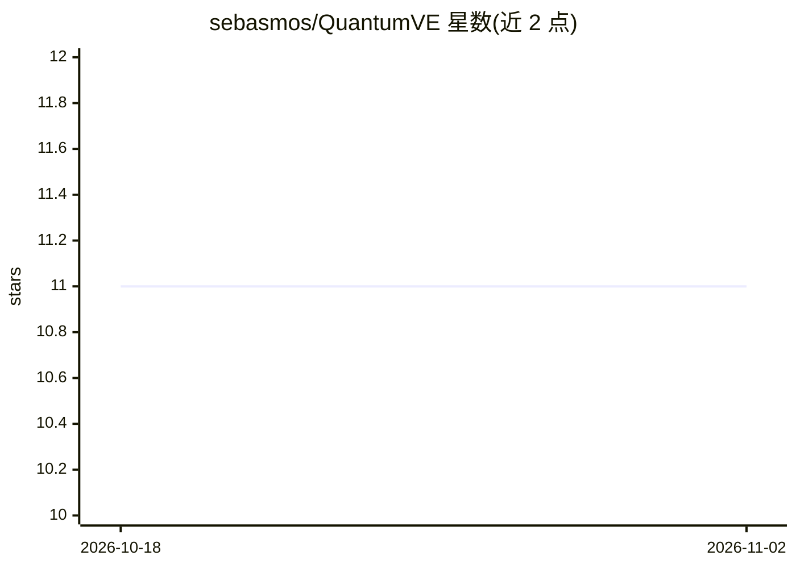

# sebasmos/QuantumVE

⭐ 11 · Jupyter Notebook · MIT · 推送 2026-08-05 · [GitHub](https://github.com/sebasmos/QuantumVE) · [官网](https://sebasmos.github.io/embedding-aware-quantum/) · 组织维护

**用 ViT 嵌入驱动的可扩展量子 SVM 研究代码与实验框架**

量子机器学习研究项目：提取 Vision Transformer 嵌入并输入量子 SVM，研究嵌入选择对量子核表现的影响。机制包括类别平衡 k-means 蒸馏压缩数据、基于 cuTensorNet 的张量网络模拟（16 量子比特）、MPI 多节点运行；论文报告在 MNIST/Fashion MNIST 上相对经典 SVM 的准确率变化。以源码仓库形式提供，含数据下载、conda 环境配置与 Colab 演示，许可为 CC BY-NC-SA 4.0（禁止商用）。

## 筛选速览

| 维度 | 判定 | 备注 |
|---|---|---|
| AI 角色 | `ai-native` | 本体是模型或模型工具 |
| 许可风险 | `permissive` | MIT |
| 部署形态 | `None` |  |
| 模型依赖 | — | README 未给出锁定关系 |
| 硬件要求 | — | 无带数字的原话,不猜 |
| 安装摩擦 | `low` | 无编译、无系统依赖或容器化 |
| 成熟度 | — | 结构信号不足 |

## 能力要点

- Vision Transformer 与 CNN 嵌入提取与对比实验
- 类别平衡 k-means 蒸馏做量子数据预处理
- cuTensorNet 张量网络模拟扩展到 16 量子比特
- 支持 MPI 多节点运行与交叉验证基线脚本

## 适用场景

- 复现论文中 ViT 嵌入量子 SVM 实验
- 研究嵌入选择对量子核分类表现的影响
- 在预计算嵌入数据集上做量子/经典 SVM 对比

## 场景标签

 · 领域:量子机器学习/科研

## 证据(README 行号)

> L11: # Embedding Aware Quantum Classical SVMs for Scalable Quantum Machine Learning
> L29: * **Embedding Insights:** ViT embeddings enable quantum advantage; CNN features degrade performance
> L30: * **Scalability:** 16 qubit tensor network simulation via cuTensorNet

## 星数曲线

2026-10-18 11 → 2026-11-02 11（+0）

---
*卡片 v1 · prompt 1.4 · 生成 2026-11-01 · 置信度 high · 依据 README sha `aaa6ce35b058` · [字段定义](../../DATASET.md)*
