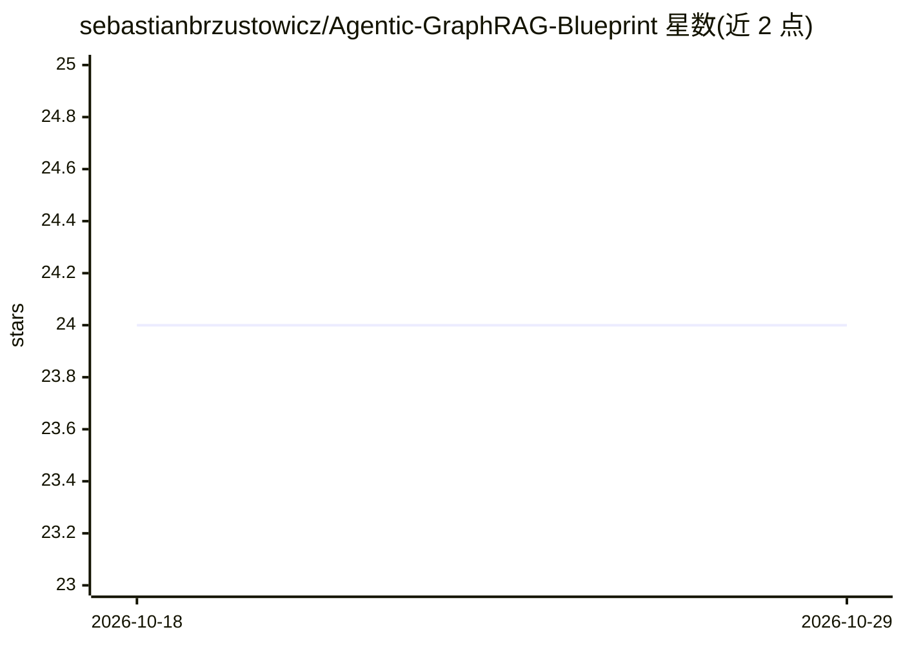

# sebastianbrzustowicz/Agentic-GraphRAG-Blueprint

⭐ 24 · Python · MIT · 推送 2026-08-29 · [GitHub](https://github.com/sebastianbrzustowicz/Agentic-GraphRAG-Blueprint) · 个人维护 · 中文 README

**给开发者的 Azure GraphRAG 参考架构蓝图（Python+Terraform）**

提供一套可运行的 Agentic GraphRAG 参考实现：FastAPI 后端 + React 前端原型，用 docker compose 一键启动；通过知识图谱（NetworkX）+ 向量索引（ChromaDB）做混合检索，支持 Local/Global 两种查询模式与增量摄取（内容哈希跳过未变文档，仅重建受影响社区报告）。图/向量存储经抽象接口可替换。云端部署用 Terraform 在 Azure 上预配资源，含 CI/CD 流水线与 Entra ID 认证。需 OpenAI API key。面向知识密集领域（科学文献、法律文档等）跨文档问答系统的构建。

## 筛选速览

| 维度 | 判定 | 备注 |
|---|---|---|
| AI 角色 | `ai-ecosystem` | LLM/agent 周边工具 |
| 许可风险 | `permissive` | MIT |
| 部署形态 | `self-host` | docker 或自建部署 |
| 模型依赖 | — | README 未给出锁定关系 |
| 硬件要求 | — | 无带数字的原话,不猜 |
| 安装摩擦 | `low` | 无编译、无系统依赖或容器化 |
| 成熟度 | — | 结构信号不足 |

## 能力要点

- 知识图谱 + 向量索引的混合检索（Local 事实级 / Global 跨文档综合）
- 增量摄取：按内容哈希跳过未变文档，仅重建受影响社区报告
- AbstractGraphStore / AbstractVectorStore 抽象使后端可替换
- Terraform 一键预配 Azure 全栈，GitHub Actions CI/CD 部署

## 适用场景

- 搭建科研/法律/医疗文献的跨文档问答系统
- 以可运行原型起步，经 Terraform 迁移到 Azure 可扩展部署
- 按需修改 prompts.json 将助手定制到特定领域

## 场景标签

`文档问答` `知识图谱` `RAG` · 领域:知识与检索

## 证据(README 行号)

> L13: A reference architecture for an Agentic GraphRAG (Knowledge Graph + Vector Search) solution deployed on Microsoft A
> L15: This repository is a ready-made starting point for building systems that answer questions over large, unstructured 
> L96: The repository ships with a runnable prototype: a FastAPI backend (`backend/`) and a React frontend (`frontend/`).

## 星数曲线

2026-10-18 24 → 2026-10-29 24（+0）

---
*卡片 v1 · prompt 1.4 · 生成 2026-10-27 · 置信度 high · 依据 README sha `2f0d390644d1` · [字段定义](../../DATASET.md)*
