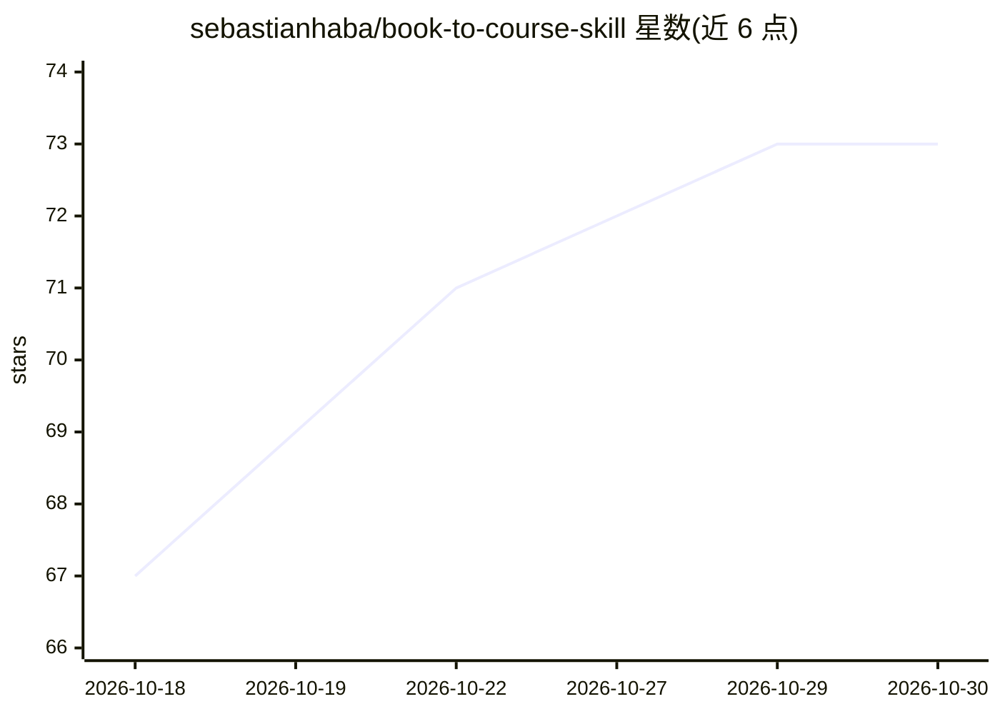

# sebastianhaba/book-to-course-skill

⭐ 73 · Python · MIT · 推送 2026-10-06 · [GitHub](https://github.com/sebastianhaba/book-to-course-skill) · 个人维护

**把书籍文档转成交互式课程的 Claude 技能（含 APK/AppImage 打包）**

Claude Code 插件市场中的技能集：读取 EPUB/PDF/HTML/DOCX/Markdown 等书籍文档，按章节规划课程并生成本地 Web 课程文件夹，含分步讲解、动画演示、测验、章节测试、闪卡与带单元测试的编程练习；打包前校验测试在初始代码上失败、在参考解上通过。课程可用 start.sh/start.bat 启动本地服务器保存进度；另有 course-to-apk 技能把课程打包为离线 Android 应用（需 JDK 17+ 与 Android SDK 构建工具），以及 course-to-appimage 技能打包为自包含 Linux AppImage（基于 Electron，无需编译）。

## 筛选速览

| 维度 | 判定 | 备注 |
|---|---|---|
| AI 角色 | `ai-native` | 本体是模型或模型工具 |
| 许可风险 | `permissive` | MIT |
| 部署形态 | `None` |  |
| 模型依赖 | locked-api |  |
| 硬件要求 | — | 无带数字的原话,不猜 |
| 安装摩擦 | `medium` | 含编译或系统依赖之一 |
| 成熟度 | — | 结构信号不足 |

## 能力要点

- 支持 EPUB/PDF/HTML/DOCX/Markdown/纯文本输入，生成分步课程、测验、闪卡与编程练习
- 编程练习经单元测试校验：初始代码必须失败、参考解必须通过
- course-to-apk 技能直接用 Android SDK 工具构建离线 WebView APK，无需 Gradle/Android Studio
- course-to-appimage 技能打包为单文件自包含 AppImage（Electron，约 115 MB）

## 适用场景

- 把自己的书或文档转成可在浏览器本地运行的交互式课程
- 把生成的课程打包成 Android 应用在手机/平板离线学习
- 把课程打包成 AppImage 在 Linux 桌面分发使用

## 场景标签

`AI 写作` · 领域:内容生成

## 证据(README 行号)

> L3: Turn a book into an interactive course you can run locally in a browser. This Claude skill uses the source material 
> L26: This repository is a Claude Code plugin marketplace. In Claude Code, add the marketplace and install the plugin:
> L55: 1. Give the skill a book or document and ask it to create a course. You can specify the course language and scope.

## 星数曲线

2026-10-18 67 → 2026-10-30 73（+6）

---
*卡片 v1 · prompt 1.4 · 生成 2026-10-24 · 置信度 high · 依据 README sha `c201896b4c4c` · [字段定义](../../DATASET.md)*
