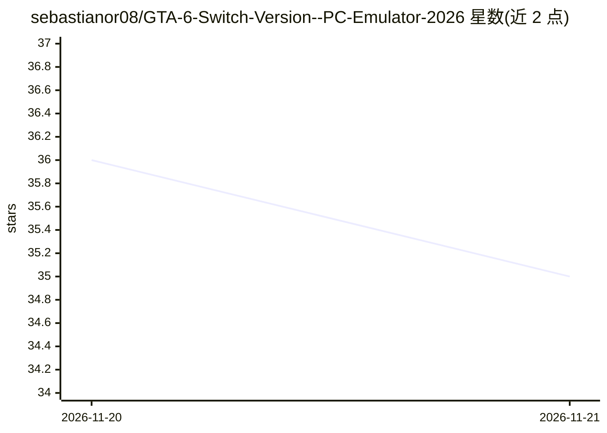

# sebastianor08/GTA-6-Switch-Version--PC-Emulator-2026

⭐ 35 · Rust · Apache-2.0 · 推送 2026-11-19 · [GitHub](https://github.com/sebastianor08/GTA-6-Switch-Version--PC-Emulator-2026) · 个人维护

**面向 Windows 玩家的 GTA VI PC 版安装与配置准备指南**

面向 Windows 10/11 用户的 Grand Theft Auto VI PC 版准备资源：提供系统兼容性检查清单（Windows 版本、DirectX、显卡驱动、存储空间）、Rockstar Games Launcher 准备步骤、图形与 FPS 优化思路及常见安装/性能问题排查条目。README 明确声明 PC 版发布日期与官方硬件要求尚未公布，配套安装器不含游戏文件，游戏需通过授权渠道另行获取。内容以指南文档为主，附下载入口与 FAQ。

## 筛选速览

| 维度 | 判定 | 备注 |
|---|---|---|
| AI 角色 | `ai-knowledge` | 知识聚合/清单类 |
| 许可风险 | `permissive` | Apache-2.0 |
| 部署形态 | `desktop` | 安装包/桌面程序 |
| 模型依赖 | — | README 未给出锁定关系 |
| 硬件要求 | — | 无带数字的原话,不猜 |
| 安装摩擦 | `low` | 无编译、无系统依赖或容器化 |
| 成熟度 | `idea` | |

## 能力要点

- Windows 兼容性准备清单：系统版本、DirectX、驱动、存储检查
- 分步 PC 准备流程（更新系统/驱动/存储/启动器/游戏设置）
- 图形与 FPS 优化因素说明及常见性能问题排查条目
- 官方明确 PC 版要求未公布，配置表全部标注为未确认

## 适用场景

- 提前检查电脑是否满足未来 GTA VI PC 版的运行条件
- 按步骤更新 Windows 与显卡驱动为游戏发布做准备
- 排查 PC 游戏常见的低帧率、卡顿与安装报错问题

## 场景标签

 · 领域:游戏/指南文档

## 证据(README 行号)

> L3: ### GTA 6 PC Installation, Setup & Performance Guide
> L49: The companion installer does not contain or install GTA VI game files.

## 星数曲线

2026-11-20 36 → 2026-11-21 35（-1）

---
*卡片 v1 · prompt 1.4 · 生成 2026-11-20 · 置信度 mid · 依据 README sha `6954d37a13d3` · [字段定义](../../DATASET.md)*
