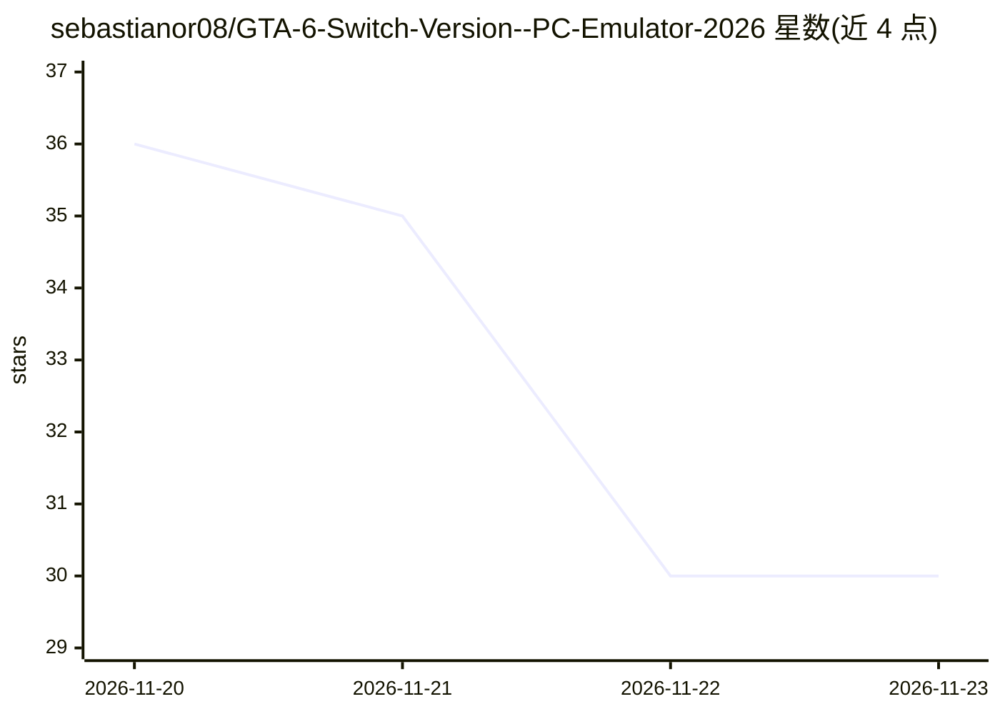

# sebastianor08/GTA-6-Switch-Version--PC-Emulator-2026

⭐ 30 · Rust · Apache-2.0 · 推送 2026-11-21 · [GitHub](https://github.com/sebastianor08/GTA-6-Switch-Version--PC-Emulator-2026) · 个人维护

**GTA VI PC 版准备指南与 Windows 安装辅助工具站点**

面向 Windows 10/11 用户的 GTA VI PC 版准备资源，覆盖系统准备步骤（Windows 更新、GPU 驱动、存储检查、Rockstar Games Launcher 设置）、图形与 FPS 优化建议、常见安装与显示问题排查。README 明确声明其安装包不含游戏文件，仅为独立的 Windows 配置辅助工具；官方 PC 版发布日期与硬件需求均未公布，相关表格留空待更新。末尾含 SEO 关键词区块，标签中的 ai/generative-ai 在 README 中无对应内容。

## 筛选速览

| 维度 | 判定 | 备注 |
|---|---|---|
| AI 角色 | `ai-enhanced` | 去掉 AI 部分产品仍成立 |
| 许可风险 | `permissive` | Apache-2.0 |
| 部署形态 | `desktop` | 安装包/桌面程序 |
| 模型依赖 | — | README 未给出锁定关系 |
| 硬件要求 | — | 无带数字的原话,不猜 |
| 安装摩擦 | `low` | 无编译、无系统依赖或容器化 |
| 成熟度 | — | 结构信号不足 |

## 能力要点

- 五步 PC 准备流程（系统更新/驱动/存储/Launcher/游戏设置）
- 图形与 FPS 优化的通用 Windows 配置建议
- 低帧率、卡顿、显示与安装错误的排查清单
- 声明安装包不含 GTA VI 游戏文件

## 适用场景

- 为 GTA VI PC 版发布提前准备 Windows 环境
- 排查 PC 游戏的常见性能与安装问题
- 了解官方 PC 版信息的更新渠道

## 场景标签

 · 领域:游戏/桌面工具

## 证据(README 行号)

> L34: The installer section is intended for a Windows setup companion associated with this project.
> L238: No. The project installer is intended for a separate Windows setup companion. GTA VI must be acquired through an a

## 星数曲线

2026-11-20 36 → 2026-11-23 30（-6）

---
*卡片 v1 · prompt 1.4 · 生成 2026-11-22 · 置信度 low · 依据 README sha `2fe487426686` · [字段定义](../../DATASET.md)*
