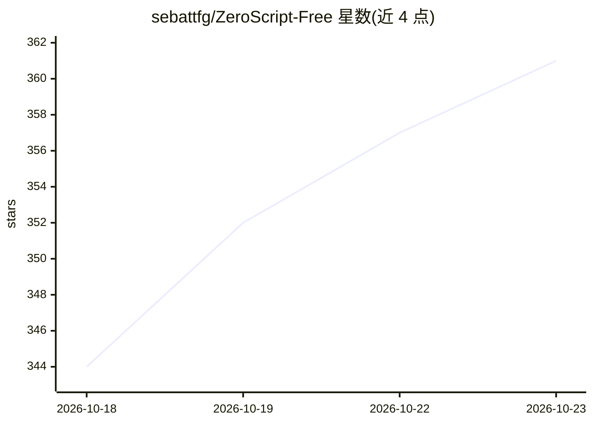

# sebattfg/ZeroScript-Free

⭐ 361 · JavaScript · GPL-3.0 · 推送 2026-09-25 · [GitHub](https://github.com/sebattfg/ZeroScript-Free) · [官网](https://discord.gg/D5G2HAzX8z) · 个人维护

**把网页版 AI 聊天变成 Roblox Studio 代理的浏览器扩展**

浏览器扩展加本地 Bridge 的组合：扩展注入 ChatGPT、DeepSeek、Gemini、Kimi、GLM、Qwen、Arena、Meta AI 八个网页聊天，把用户的自然语言请求转为命令，经本机 Bridge 驱动 Roblox Studio 内置 MCP 服务器，实现读写脚本、运行 Luau、检查游戏树、生成网格/材质/模型、控制试玩等。无需 API key 与终端，项目记忆可保存在 Place 内跨会话保留。支持 Windows/macOS，需 Edge/Chrome、Roblox Studio 与 Python 3.9+；各 AI 提供方行为有差异（如 Gemini/Kimi 不稳定，Arena 仅支持 Direct 模式），推荐 DeepSeek。

## 筛选速览

| 维度 | 判定 | 备注 |
|---|---|---|
| AI 角色 | `ai-ecosystem` | LLM/agent 周边工具 |
| 许可风险 | `viral` | GPL-3.0 |
| 部署形态 | `None` |  |
| 模型依赖 | locked-api |  |
| 硬件要求 | — | 无带数字的原话,不猜 |
| 安装摩擦 | `low` | 无编译、无系统依赖或容器化 |
| 成熟度 | — | 结构信号不足 |

## 能力要点

- 浏览器扩展 + 本地 Bridge 驱动 Roblox Studio 内置 MCP 服务器
- 支持 8 个网页版 AI 提供方，无需 API key
- 读写脚本、运行 Luau、生成网格/材质/模型、控制试玩
- 项目记忆保存在 Place 内，可跨会话保留

## 适用场景

- 在 AI 聊天页里直接让 AI 修改我的 Roblox 脚本
- 用自然语言让 AI 在 Studio 里生成模型和材质
- 不写代码、不开终端就用 AI 搭建 Roblox 游戏

## 场景标签

`编码 Agent` `GUI 自动化` · 领域:效率与自动化

## 证据(README 行号)

> L7: **ZeroScript** is a free browser extension that turns ChatGPT, DeepSeek, Gemini, Kimi, GLM, Qwen, Arena or Meta AI i
> L27: AI chat (ChatGPT / DeepSeek / Gemini / Kimi / GLM / Qwen / Arena / Meta AI, in your browser) -> ZeroScript Extensio
> L30: The extension runs inside the chat page (ChatGPT, DeepSeek, Gemini, Kimi, GLM, Qwen, Arena or Meta AI). When you ty

## 星数曲线

2026-10-18 344 → 2026-10-23 361（+17）

---
*卡片 v1 · prompt 1.4 · 生成 2026-10-21 · 置信度 high · 依据 README sha `6fb7ae0db408` · [字段定义](../../DATASET.md)*
