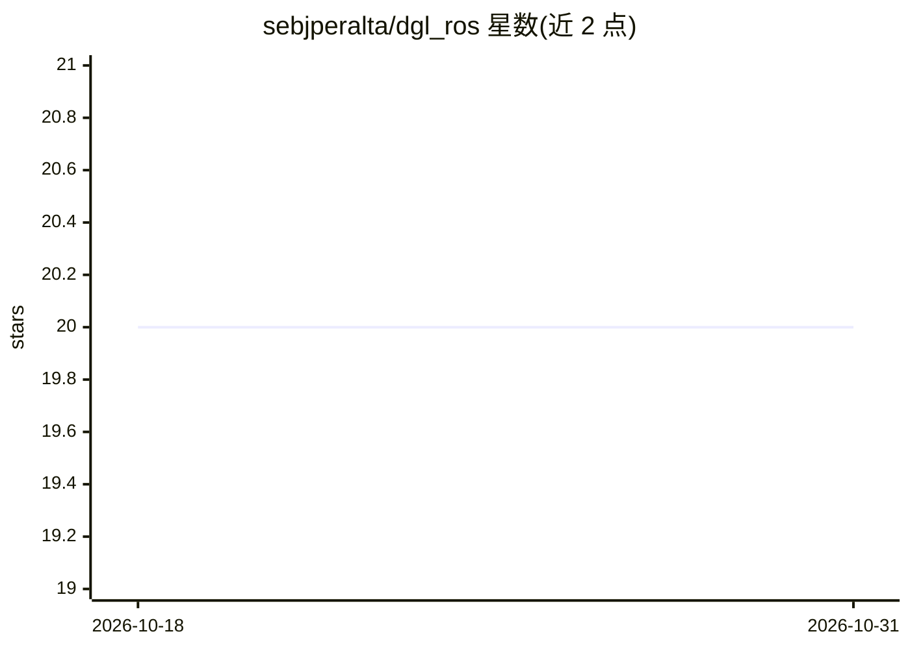

# sebjperalta/dgl_ros

⭐ 20 · C++ · MIT · 推送 2026-08-20 · [GitHub](https://github.com/sebjperalta/dgl_ros) · 个人维护

**将深度抓取模型封装为 ROS2 节点的 C++ 库**

面向机器人研究者的轻量 C++ 库，用于把深度抓取模型（如 GPD、Contact Graspnet）封装为 ROS2 动作服务器节点，通过 Observer/Actor/Supervisor 抽象处理不同模型在输入、动作空间与依赖上的差异，供机器人社区运行与实验。提供 GPD 与 Contact Graspnet 的端到端推理节点、MoveIt Task Constructor 阶段接口；集成新模型需定义 ROS 动作与消息并扩展 Agent 类。测试环境为 Ubuntu 20.04、ROS2 Humble、C++17；通过 git clone 源码经 colcon 构建，需 rosdep 安装依赖。

## 筛选速览

| 维度 | 判定 | 备注 |
|---|---|---|
| AI 角色 | `ai-ecosystem` | LLM/agent 周边工具 |
| 许可风险 | `permissive` | MIT |
| 部署形态 | `library` | 以包/库形式分发 |
| 模型依赖 | — | README 未给出锁定关系 |
| 硬件要求 | — | 无带数字的原话,不猜 |
| 安装摩擦 | `low` | 无编译、无系统依赖或容器化 |
| 成熟度 | — | 结构信号不足 |

## 能力要点

- 基类含 ObsFromSrcs/ActionFromObserver 虚方法，可为任意深度抓取模型创建 ROS2 动作服务器
- 提供 GPD 与 Contact Graspnet 的端到端推理节点，仅需 yaml 配置即可运行
- MoveIt Task Constructor 阶段接口对接上层规划管线
- Observer/Actor/Supervisor 抽象对齐 RL 库（gym/TF-Agents）的环境接口概念

## 适用场景

- 把自己的深度抓取模型封装成 ROS2 节点供社区使用
- 在仿真或实机上运行 GPD/Contact Graspnet 抓取推理
- 通过 MoveIt 规划管线调用深度抓取动作服务器

## 场景标签

 · 领域:机器人/深度学习

## 证据(README 行号)

> L6: usable AI solution extends beyond the AI model itself. **dgl_ros** is a light-weight C++ library for researchers to 
> L7: deep grasp models into a ROS node, ready to be run and experimented with by the robotics community. **dgl_ros_models
> L14: - Base class with two virtual methods, **ObsFromSrcs** and **ActionFromObserver**, to create a Ros2 action server f

## 星数曲线

2026-10-18 20 → 2026-10-31 20（+0）

---
*卡片 v1 · prompt 1.4 · 生成 2026-10-28 · 置信度 mid · 依据 README sha `e9cb126c8768` · [字段定义](../../DATASET.md)*
