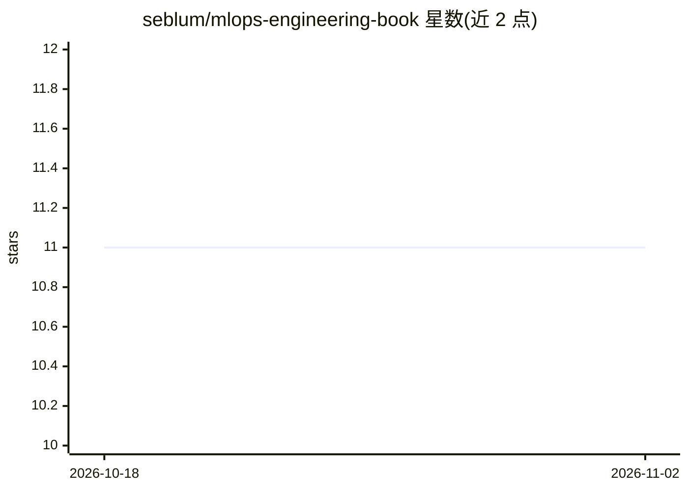

# seblum/mlops-engineering-book

⭐ 11 · Python · Apache-2.0 · 推送 2026-07-06 · [GitHub](https://github.com/seblum/mlops-engineering-book) · 个人维护

**MLOps 工程实践在线书籍：讲解 ML 模型部署与运维**

托管在 GitHub Pages 上的开源书籍项目，内容围绕 MLOps 实践：ML 平台与基础设施搭建、数据管理与版本控制、模型训练评估、部署与监控、ML 场景下的 CI/CD 流水线，以及 Kubernetes 与容器化。面向数据科学家、机器学习工程师与软件开发者。源码基于 R 的 Bookdown 框架编写，可在线阅读或本地构建（HTML 需 bookdown/rmarkdown 包，PDF 需 LaTeX），采用 Apache 2.0 许可证发布。

## 筛选速览

| 维度 | 判定 | 备注 |
|---|---|---|
| AI 角色 | `ai-knowledge` | 知识聚合/清单类 |
| 许可风险 | `permissive` | Apache-2.0 |
| 部署形态 | `None` |  |
| 模型依赖 | — | README 未给出锁定关系 |
| 硬件要求 | — | 无带数字的原话,不猜 |
| 安装摩擦 | `low` | 无编译、无系统依赖或容器化 |
| 成熟度 | — | 结构信号不足 |

## 能力要点

- 覆盖 ML 基础设施、数据版本化、模型部署与监控等 MLOps 主题
- 基于 Bookdown 框架编写，支持在线阅读与本地构建（HTML/PDF）
- 以 GitHub Pages 形式发布（seblum.github.io/mlops-engineering-book）

## 适用场景

- 系统学习 MLOps 原则、工具与工程实践
- 参考 ML 项目全生命周期（数据到部署监控）的方法论
- 在本地构建或为书籍内容贡献修改

## 场景标签

`教程课程` `MLOps` · 领域:学习与行业

## 证据(README 行号)

> L5: Welcome to the MLOps Engineering Book repository! This project hosts the source code and content for the MLOps Engin
> L21: Whether you are a data scientist, machine learning engineer, or software developer, this book is designed to equip 

## 星数曲线

2026-10-18 11 → 2026-11-02 11（+0）

---
*卡片 v1 · prompt 1.4 · 生成 2026-11-01 · 置信度 high · 依据 README sha `64b332e5db86` · [字段定义](../../DATASET.md)*
