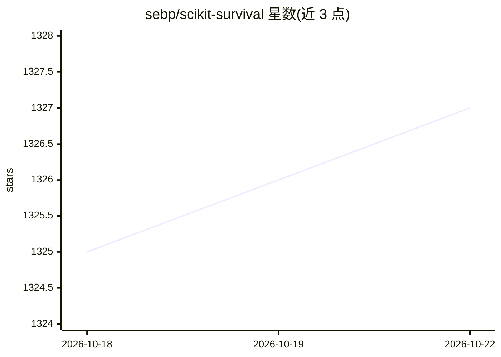

# sebp/scikit-survival

⭐ 1,327 · Python · GPL-3.0 · 推送 2026-10-20 · [GitHub](https://github.com/sebp/scikit-survival) · 个人维护

**基于 scikit-learn 的生存分析 Python 库**

面向研究者和数据分析人员的 Python 模块，提供时间至事件（time-to-event）分析方法，构建在 scikit-learn 之上，可复用其预处理与交叉验证机制。处理训练数据部分观测（删失/censored）场景，如临床研究中患者未发生事件即结束随访。要求 Python 3.11+、scikit-learn 1.9、numpy 2.0+、pandas 2.2+ 等依赖及 C/C++ 编译器。可通过 conda-forge 或 PyPI 安装，附 Jupyter notebook 用户指南；有 JMLR 论文可引用。

## 筛选速览

| 维度 | 判定 | 备注 |
|---|---|---|
| AI 角色 | `ai-native` | 本体是模型或模型工具 |
| 许可风险 | `viral` | GPL-3.0 |
| 部署形态 | `library` | 以包/库形式分发 |
| 模型依赖 | — | README 未给出锁定关系 |
| 硬件要求 | — | 无带数字的原话,不猜 |
| 安装摩擦 | `low` | 无编译、无系统依赖或容器化 |
| 成熟度 | — | 结构信号不足 |

## 能力要点

- 基于 scikit-learn 构建，支持其预处理与交叉验证流程
- 处理删失（censored）数据的时间至事件建模
- 提供 Jupyter notebook 形式的用户指南与示例
- 要求 C/C++ 编译器，包含 clarabel/ecos/osqp 等求解器依赖

## 适用场景

- 临床研究中建立协变量与事件时间的关联模型
- 对含删失记录的随访数据做生存分析
- 在 scikit-learn 流水线中纳入生存模型与交叉验证

## 场景标签

 · 领域:机器学习/统计分析

## 证据(README 行号)

> L7: scikit-survival is a Python module for `survival analysis`_
> L8: built on top of `scikit-learn <https://scikit-learn.org/>`_. It allows doing survival analysis
> L24: Consequently, survival analysis demands for models that take

## 星数曲线

2026-10-18 1,325 → 2026-10-22 1,327（+2）

---
*卡片 v1 · prompt 1.4 · 生成 2026-10-21 · 置信度 high · 依据 README sha `1f81838f6b31` · [字段定义](../../DATASET.md)*
