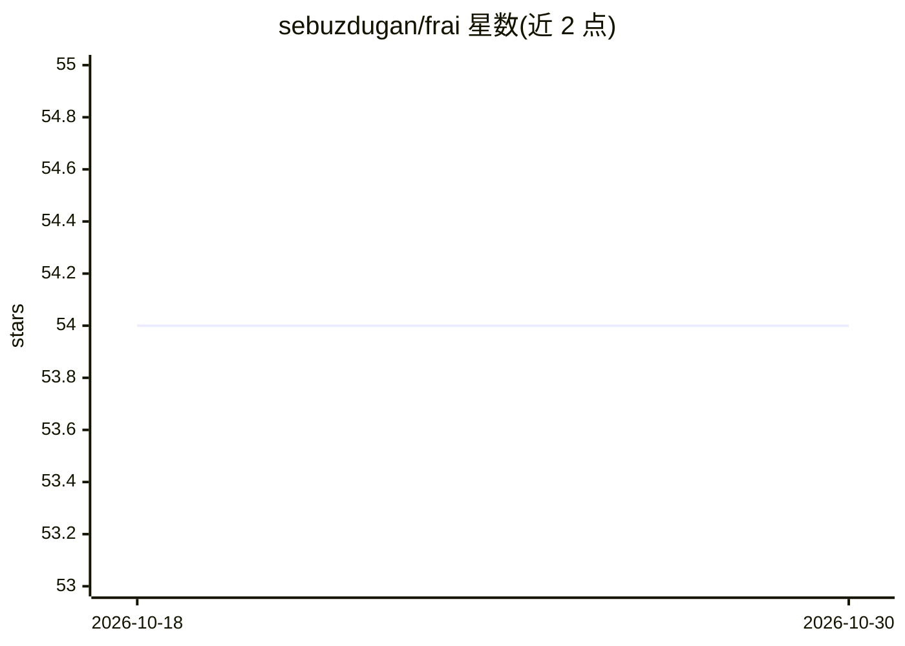

# sebuzdugan/frai

⭐ 54 · TypeScript · MIT · 推送 2026-10-14 · [GitHub](https://github.com/sebuzdugan/frai) · [官网](https://frai.cc) · 个人维护

**面向开发者的 AI 披露合规检查 CLI：核验代码、站点与规格文档是否告知用户在用 AI**

面向需要遵守 EU AI Act Article 50 披露要求的开发者的命令行工具。一条命令做三件事：扫描代码找出 AI SDK 调用与 UI 中的告知语句（定位到文件与行）、以访客方式读取线上站点与聊天组件的首屏内容判断是否有 AI 告知、通过 FRAI-SPEC.md 的七个问题要求人工回答风险分级/数据/监督等。`frai draft` 可从代码起草规格，未知处标注 NEEDS HUMAN INPUT。提供 CI 门禁，门禁本身确定性运行（无模型、无 key）；`--smart` 可选触发 AI 审查；站点检查经 frai.cc 代理，可用 --offline 跳过；spec 起草用用户自己的 Claude。npm 包：frai、frai-gate、frai-core。MIT 许可，声明非法律建议。

## 筛选速览

| 维度 | 判定 | 备注 |
|---|---|---|
| AI 角色 | `ai-ecosystem` | LLM/agent 周边工具 |
| 许可风险 | `permissive` | MIT |
| 部署形态 | `library` | 以包/库形式分发 |
| 模型依赖 | — | README 未给出锁定关系 |
| 硬件要求 | — | 无带数字的原话,不猜 |
| 安装摩擦 | `low` | 无编译、无系统依赖或容器化 |
| 成熟度 | — | 结构信号不足 |

## 能力要点

- 代码扫描识别 AI SDK 与模型调用（OpenAI/Anthropic/Gemini/LangChain 等 12 家）并定位 UI 告知语句到文件与行
- 通过厂商自有 API 打开聊天组件读取首屏，页面扫描读不到的告知也能检测，读不到时如实说明
- FRAI-SPEC.md 七问规格（风险分级/数据/监督/评测/偏见/监控/透明），gate 阻塞直到人工回答
- CI 门禁确定性运行：无模型、无 key，--offline 可完全本地

## 适用场景

- 在 PR 中自动拦截未声明 AI 使用或规格未回答的改动
- 检查线上产品聊天组件是否按 EU AI Act 第 50 条告知用户在与 AI 对话
- 生成并维护 AI 使用披露规格文档供合规审查

## 场景标签

`代码审查` · 领域:编码与开发

## 证据(README 行号)

> L27: One command, three questions: which AI your code calls and where the notice is, whether the live site says it, and 
> L61: Drop `--offline` to also fail when the live site has no notice. The gate is deterministic: no model, no key. Add `-
> L29: - **Code.** Finds AI SDKs and model calls (OpenAI, Anthropic, Gemini, LangChain and 8 more), then the sentence in y

## 星数曲线

2026-10-18 54 → 2026-10-30 54（+0）

---
*卡片 v1 · prompt 1.4 · 生成 2026-10-24 · 置信度 high · 依据 README sha `4d9f551f6b8d` · [字段定义](../../DATASET.md)*
