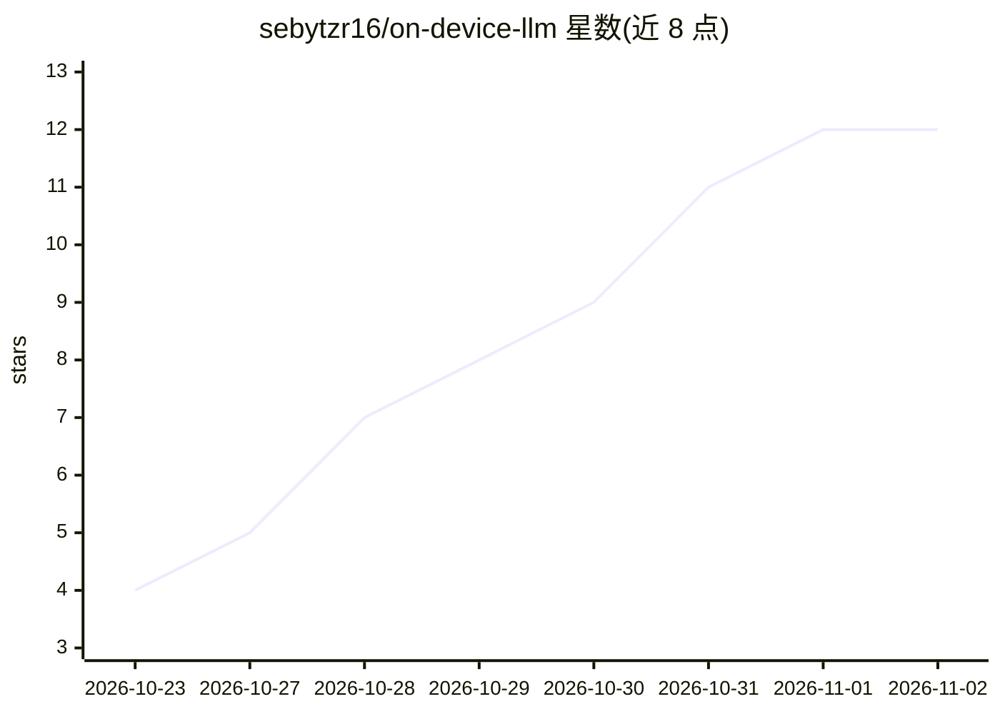

# sebytzr16/on-device-llm

⭐ 12 · Dart · NOASSERTION · 推送 2026-10-30 · [GitHub](https://github.com/sebytzr16/on-device-llm) · [官网](https://github.com/sebytzr16/on-device-llm/releases/latest) · 个人维护

**Android/Windows 本地离线 AI 助手：手机或 PC 上运行 GGUF 模型**

基于 Flutter 与 llama.cpp 构建的开源本地 LLM 应用，在 Android（CPU/OpenCL）与 Windows（CUDA/Vulkan/CPU）上直接运行 GGUF 模型，支持流式聊天、照片与文档问答（OCR 与视觉模型）、本地 RAG 知识库、Whisper/Parakeet 语音转写、Kokoro 语音合成、带引用核验的网页检索（默认关闭）及 Windows 端文生图/视频。Windows 版提供 OpenAI/Anthropic 兼容本地服务器，可作为手机端远程后端，也可连接 LM Studio、Ollama 或托管 API。无账号、无遥测，MIT 许可，提供 APK 与 Windows 安装包；尚无 iOS/macOS 版本，Windows 构建未签名。

## 筛选速览

| 维度 | 判定 | 备注 |
|---|---|---|
| AI 角色 | `ai-native` | 本体是模型或模型工具 |
| 许可风险 | `permissive` | NOASSERTION |
| 部署形态 | `desktop` | 安装包/桌面程序 |
| 模型依赖 | local-ok | 支持本地模型 |
| 硬件要求 | — | 无带数字的原话,不猜 |
| 安装摩擦 | `high` | 编译与系统依赖俱全 |
| 成熟度 | — | 结构信号不足 |

## 能力要点

- 本地运行 GGUF 模型，支持 CPU/CUDA/Vulkan/OpenCL 加速，可离线工作
- 照片/文档问答、本地 RAG 知识库与引用核验的网页检索
- 端侧语音链路：Whisper/Parakeet 转写 + Kokoro 语音合成
- Windows 端提供 OpenAI/Anthropic 兼容本地服务器，可与手机配对

## 适用场景

- 在手机或 PC 上离线进行私密对话，数据不离开设备
- 对照片和 PDF/Office 等文档提问，建立可检索的个人知识库
- 用手机调用 PC 上的大模型，或让 PC 充当本地 API 服务器

## 场景标签

`AI 助手` `文档问答` `RAG` · 领域:对话与助手

## 证据(README 行号)

> L3: **Run open AI models (Gemma 4, Qwen) on your own phone or PC.** Chat, ask
> L9: llama.cpp. It runs GGUF models on
> L92: - Runs GGUF models locally. Answers stream as they are written. You can

## 星数曲线

2026-10-23 4 → 2026-11-02 12（+8）

---
*卡片 v1 · prompt 1.4 · 生成 2026-11-01 · 置信度 high · 依据 README sha `7c5626f6d175` · [字段定义](../../DATASET.md)*
