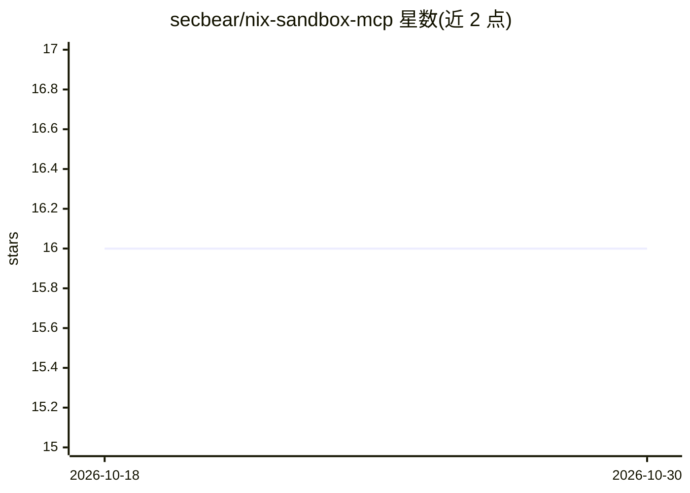

# secbear/nix-sandbox-mcp

⭐ 16 · Rust · MIT · 推送 2026-07-23 · [GitHub](https://github.com/secbear/nix-sandbox-mcp) · 个人维护

**给 LLM 的本地沙箱代码执行 MCP 服务器，基于 Nix**

面向 MCP 客户端的代码执行服务器：通过 Nix flake 声明环境，使用 jail.nix（bubblewrap + Linux 命名空间，无需 root）做沙箱隔离，默认无网络访问，项目目录只读挂载。内置 shell/python/node 三个环境，支持自定义 flake 环境与持久会话。设计上只暴露单一参数化的 run 工具，将上下文开销固定在约 420 token，不随环境数量增长。限制：仅支持启用 flakes 的 Linux，macOS/Windows 不支持；microvm.nix 的 VM 级隔离为规划中功能。

## 筛选速览

| 维度 | 判定 | 备注 |
|---|---|---|
| AI 角色 | `ai-ecosystem` | LLM/agent 周边工具 |
| 许可风险 | `permissive` | MIT |
| 部署形态 | `None` |  |
| 模型依赖 | — | README 未给出锁定关系 |
| 硬件要求 | — | 无带数字的原话,不猜 |
| 安装摩擦 | `low` | 无编译、无系统依赖或容器化 |
| 成熟度 | — | 结构信号不足 |

## 能力要点

- Nix flake 声明式定义沙箱环境，bubblewrap + 命名空间隔离且无需 root
- 内置 shell/python/node 环境，项目目录只读挂载到 /project
- 单一参数化 run 工具设计，上下文成本固定约 420 token
- 支持 session ID 跨调用保留变量与导入，默认无网络访问

## 适用场景

- 让 MCP 客户端中的 LLM 在隔离沙箱内运行 Python/Node/Shell 代码
- 用自定义 Nix flake 为 agent 提供特定依赖的工具环境
- 在不使用 Docker 的情况下本地执行不可信代码（基础隔离）

## 场景标签

`Agent 框架` · 领域:Agent 开发

## 证据(README 行号)

> L3: Sandboxed code execution for LLMs, powered by Nix.
> L111: MCP Client

## 星数曲线

2026-10-18 16 → 2026-10-30 16（+0）

---
*卡片 v1 · prompt 1.4 · 生成 2026-10-30 · 置信度 high · 依据 README sha `742baf04d795` · [字段定义](../../DATASET.md)*
