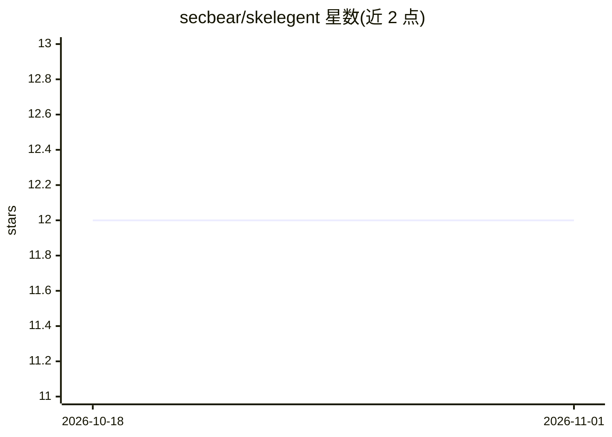

# secbear/skelegent

⭐ 12 · Rust · Apache-2.0 · 推送 2026-06-01 · [GitHub](https://github.com/secbear/skelegent) · [官网](https://secbear.github.io/skelegent) · 个人维护

**Rust 可组合 agentic AI 框架：分层协议、可替换组件**

以可组合性为核心设计的 Rust agentic 运行时实验项目：提供分层协议契约（layer0 协议 trait 与 wire contract）、可替换的 provider/tool/state 组件，以及 ReAct 式与单次执行两类 operator 循环和本地编排器。Provider 支持 Anthropic、OpenAI、Ollama；附带安全中间件（RedactionMiddleware、ExfilGuardMiddleware）、秘密管理（含 HashiCorp Vault 后端）与内存/文件系统两种状态存储。重型依赖实现（SQLite、CozoDB、Temporal 等）拆分至 skelegent-extras 仓库。规范文件（SPECS.md 与 specs/）作为事实来源，通过 Nix 提供 Rust 工具链。

## 筛选速览

| 维度 | 判定 | 备注 |
|---|---|---|
| AI 角色 | `ai-ecosystem` | LLM/agent 周边工具 |
| 许可风险 | `permissive` | Apache-2.0 |
| 部署形态 | `None` |  |
| 模型依赖 | local-ok | 支持本地模型 |
| 硬件要求 | — | 无带数字的原话,不猜 |
| 安装摩擦 | `low` | 无编译、无系统依赖或容器化 |
| 成熟度 | `idea` | |

## 能力要点

- 分层协议契约与可替换 provider/tool/state 组件
- skg-mcp 提供 MCP client/server
- 安全中间件：RedactionMiddleware 与 ExfilGuardMiddleware
- 重型依赖实现拆分至 skelegent-extras 独立仓库

## 适用场景

- 用 Rust 构建可替换组件的 agentic 系统
- 接入 Anthropic/OpenAI/Ollama 作为 provider
- 需要安全脱敏与防外泄中间件的 agent 部署

## 场景标签

`Agent 框架` · 领域:Agent 开发

## 证据(README 行号)

> L3: Skelegent is an experiment in building an agentic system that is **composable by construction**:
> L25: - `skg-turn` — turn types + provider abstraction
> L33: - `skg-context-engine` — ReAct-style operator loop

## 星数曲线

2026-10-18 12 → 2026-11-01 12（+0）

---
*卡片 v1 · prompt 1.4 · 生成 2026-11-01 · 置信度 high · 依据 README sha `38d60883bd26` · [字段定义](../../DATASET.md)*
