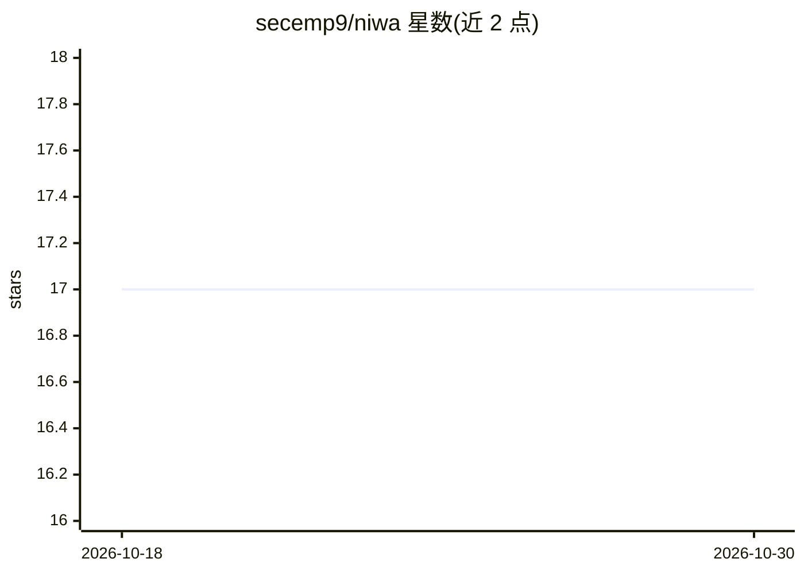

# secemp9/niwa

⭐ 17 · Python · MIT · 推送 2026-02-07 · [GitHub](https://github.com/secemp9/niwa) · [官网](https://pypi.org/project/niwa) · 个人维护

**多 LLM agent 并发协作编辑 Markdown 的冲突感知 CLI**

面向 LLM agent 与开发者的命令行工具：将 Markdown 文档解析为节点树存入 LMDB，多个 agent 可并发读写，通过版本追踪自动检测同节点的编辑冲突，提供 4 种冲突解决选项、自动合并建议、版本历史与回滚。支持子 agent 上下文切换后恢复状态（冲突持久化存储），提供 Claude Code hooks 集成，在会话启动与压缩时注入使用上下文。支持导出为 Markdown，含 84 个测试。

## 筛选速览

| 维度 | 判定 | 备注 |
|---|---|---|
| AI 角色 | `ai-ecosystem` | LLM/agent 周边工具 |
| 许可风险 | `permissive` | MIT |
| 部署形态 | `library` | 以包/库形式分发 |
| 模型依赖 | — | README 未给出锁定关系 |
| 硬件要求 | — | 无带数字的原话,不猜 |
| 安装摩擦 | `low` | 无编译、无系统依赖或容器化 |
| 成熟度 | — | 结构信号不足 |

## 能力要点

- 基于 LMDB 的多 agent 并发读写与 ACID 事务
- 节点级版本追踪与冲突检测，冲突跨上下文持久化
- Claude Code hooks 集成（SessionStart/PreCompact 等 5 种事件）
- AST 解析保留原始格式，完整支持 GFM 表格/任务列表/frontmatter

## 适用场景

- 多个 LLM agent 协作编辑规格/规划文档时避免相互覆盖
- 在 Claude Code 中维护可回滚的结构化文档
- 编辑冲突发生时查看差异并选择保留版本

## 场景标签

`多智能体` · 领域:Agent 开发

## 证据(README 行号)

> L12: Niwa (庭, "garden") is a CLI tool that enables multiple LLM agents to collaboratively edit markdown documents with a
> L18: - **Concurrent Editing**: Multiple agents can read/edit simultaneously

## 星数曲线

2026-10-18 17 → 2026-10-30 17（+0）

---
*卡片 v1 · prompt 1.4 · 生成 2026-10-30 · 置信度 high · 依据 README sha `377c4cf36698` · [字段定义](../../DATASET.md)*
