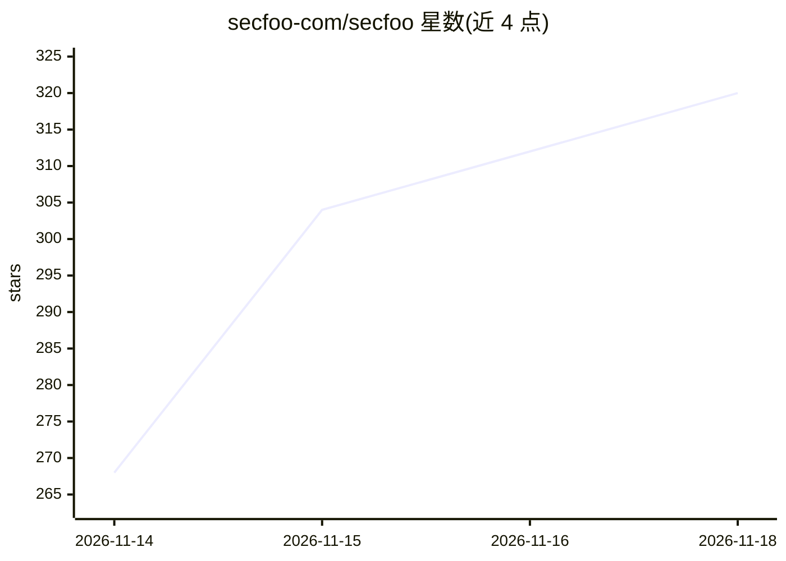

# secfoo-com/secfoo

⭐ 320 · Python · MIT · 推送 2026-11-17 · [GitHub](https://github.com/secfoo-com/secfoo) · [官网](https://secfoo.com) · 组织维护

**把编程 Agent 变成安全审查 CLI：SAST、密钥扫描与威胁建模**

面向开发者的 AI 安全审查命令行工具：将结构化提示（skill）交给本机已有的编程 Agent（Claude Code、Codex、Gemini CLI、Copilot、Cursor 等）或 API key，对代码仓库执行 SAST、密钥扫描、SCA、威胁建模与架构审查，产出固定格式的报告，可导出 SARIF/JSONL 并接入 CI。通过 MCP 读取 Confluence、Jira、设计文档等上下文，对比文档与实现的差异。支持本地目录、GitHub/GitLab/Bitbucket 目标，多 skill 并发运行，提供本地仪表盘。

## 筛选速览

| 维度 | 判定 | 备注 |
|---|---|---|
| AI 角色 | `ai-native` | 本体是模型或模型工具 |
| 许可风险 | `permissive` | MIT |
| 部署形态 | `self-host` | docker 或自建部署 |
| 模型依赖 | locked-api |  |
| 硬件要求 | — | 无带数字的原话,不猜 |
| 安装摩擦 | `low` | 无编译、无系统依赖或容器化 |
| 成熟度 | — | 结构信号不足 |

## 能力要点

- 复用 PATH 上已有的编程 Agent 或 OPENAI/ANTHROPIC/GEMINI API key 作为执行引擎
- 9 类安全 skill：SAST、密钥扫描、SCA、威胁建模、架构审查、Responsible AI 合规等
- 通过 MCP 接入 Confluence/Jira/Notion 等文档源，报告含文档覆盖说明
- SARIF 2.1.0 / JSON Lines 导出，GitHub Action、pre-commit、GitLab CI 集成，--fail-on 等策略门控

## 适用场景

- 在 CI 中对仓库做 SAST 与密钥扫描并在 PR 上标注发现
- 结合 Confluence 设计文档做威胁建模与安全架构审查
- 用已有编程 Agent 执行统一清单制的安全审查并汇总到仪表盘

## 场景标签

`代码审查` `网络安全` · 领域:编码与开发

## 证据(README 行号)

> L3: # secfoo — AI security review CLI
> L5:  Turn the coding agent you already have into a disciplined security reviewer.
> L91: - **A skill is a brief, not a parser.** secfoo hands your coding agent a

## 星数曲线

2026-11-14 268 → 2026-11-18 320（+52）

---
*卡片 v1 · prompt 1.4 · 生成 2026-11-17 · 置信度 high · 依据 README sha `89e608a741d4` · [字段定义](../../DATASET.md)*
