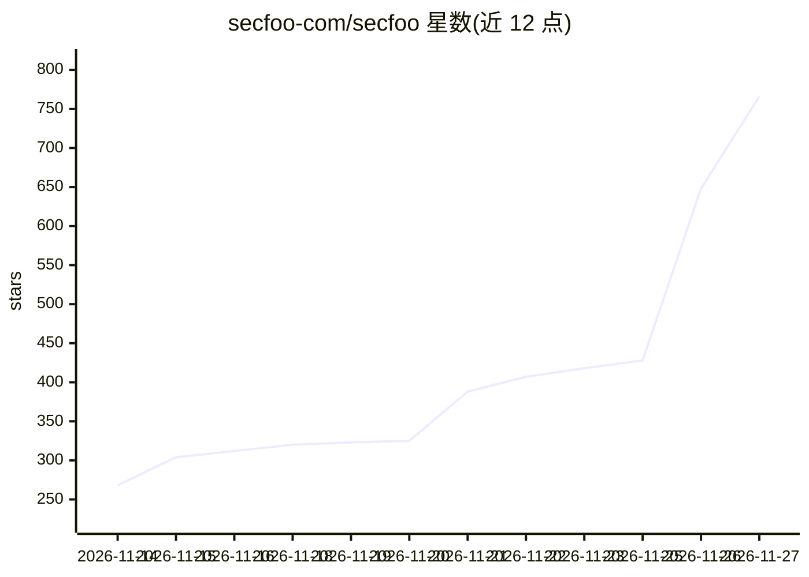

# secfoo-com/secfoo

⭐ 766 · Python · MIT · 推送 2026-11-26 · [GitHub](https://github.com/secfoo-com/secfoo) · [官网](https://secfoo.com) · 组织维护

**AI 安全审查 CLI：让既有编码 agent 按固定清单做安全扫描**

一个 Python/npm 发布的安全审查命令行工具：调用用户已安装的编码 agent（Claude Code、Codex、Gemini CLI、Copilot、Cursor 等）或直接用 API key，对目标仓库执行 SAST、密钥扫描、SCA、威胁建模与架构审查等 9 类 skill。通过 MCP 读取 Confluence、Jira、设计文档等作为审查上下文，报告输出结构固定，findings 可导出 JSON Lines 或 SARIF 2.1.0 接入 GitHub code scanning，支持 CI 门禁、花费上限与本地 dashboard。本地优先运行，云端同步为可选托管服务。

## 筛选速览

| 维度 | 判定 | 备注 |
|---|---|---|
| AI 角色 | `ai-native` | 本体是模型或模型工具 |
| 许可风险 | `permissive` | MIT |
| 部署形态 | `self-host` | docker 或自建部署 |
| 模型依赖 | — | README 未给出锁定关系 |
| 硬件要求 | — | 无带数字的原话,不猜 |
| 安装摩擦 | `low` | 无编译、无系统依赖或容器化 |
| 成熟度 | — | 结构信号不足 |

## 能力要点

- 9 类安全 skill 目录，多个 --skill 并发运行，报告结构固定
- 通过 MCP 接入 Confluence/Jira/Notion 等文档源并在报告中说明覆盖情况
- findings 导出 JSON Lines 与 SARIF 2.1.0，支持 GitHub Action、pre-commit、GitLab CI
- 自动探测 PATH 上的 agent CLI，或用 OPENAI/ANTHROPIC/GEMINI API key 的内置 api agent

## 适用场景

- 在 CI 流水线里对 PR 做安全扫描并按严重度设门禁
- 把设计文档和工单作为上下文做架构审查与威胁建模
- 导出 SARIF 在 GitHub Security 页展示安全发现

## 场景标签

`代码审查` · 领域:编码与开发

## 证据(README 行号)

> L5:  Turn the coding agent you already have into a disciplined security reviewer.
> L6:  SAST, secret scanning, SCA, threat modeling and architecture review, with your design docs, Confluence and tickets 
> L91: - **A skill is a brief, not a parser.** secfoo hands your coding agent a

## 星数曲线

2026-11-14 268 → 2026-11-27 766（+498）

---
*卡片 v1 · prompt 1.4 · 生成 2026-11-25 · 置信度 high · 依据 README sha `264f266e83a6` · [字段定义](../../DATASET.md)*
