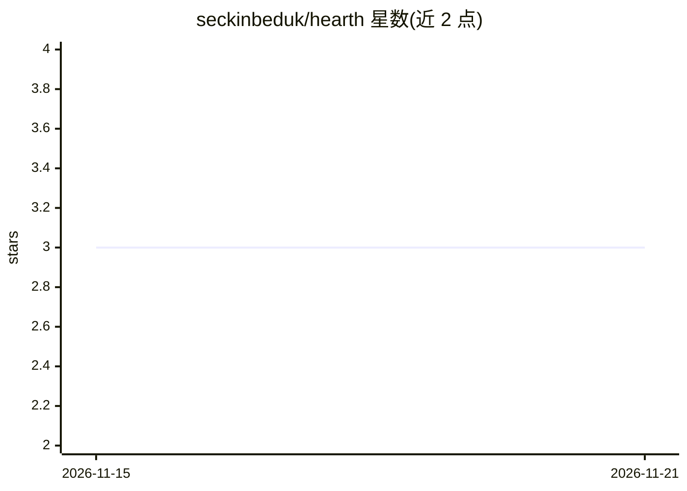

# seckinbeduk/hearth

⭐ 3 · Swift · MIT · 推送 2026-11-09 · [GitHub](https://github.com/seckinbeduk/hearth) · 个人维护

**在菜单栏把本地 MLX 模型与 Apple Intelligence 变成 OpenAI 兼容接口**

面向 Apple Silicon Mac 的菜单栏应用：检测本机芯片、内存与磁盘，推荐合适的本地 MLX 模型并在 http://localhost:8800/v1 提供 OpenAI 兼容端点，同一端点也可调用 Apple Intelligence。自动发现已在运行的 Ollama、LM Studio 等服务器与已下载模型；菜单栏显示流式 tok/s、调用应用与相对云价格的节省；通过 hooks 追踪 Claude Code 与 Codex 会话状态。服务器仅监听 loopback，提示词不离开本机。提供 DMG 安装包，也可用 Xcode 从源码构建。

## 筛选速览

| 维度 | 判定 | 备注 |
|---|---|---|
| AI 角色 | `ai-ecosystem` | LLM/agent 周边工具 |
| 许可风险 | `permissive` | MIT |
| 部署形态 | `desktop` | 安装包/桌面程序 |
| 模型依赖 | local-ok | 支持本地模型 |
| 硬件要求 | — | 无带数字的原话,不猜 |
| 安装摩擦 | `low` | 无编译、无系统依赖或容器化 |
| 成熟度 | — | 结构信号不足 |

## 能力要点

- OpenAI 兼容端点：/v1/chat/completions 支持流式与 JSON Schema 结构化输出
- 按 Metal GPU 预算与带宽估算推荐本机可运行的 MLX 模型
- 自动发现 Ollama、LM Studio、Jan、GPT4All 等运行中的服务器与磁盘模型
- 通过 hooks 展示 Claude Code / Codex 会话的权限请求与等待状态

## 适用场景

- 给 Continue、Cline、Zed、Open WebUI 等工具配置自定义 base URL 调本地模型
- 同一端点并存本地模型与 Apple Intelligence 按需分流
- 在菜单栏统一查看多个编码 Agent 会话的进展
- 仅限本机访问的私有 LLM 推理服务

## 场景标签

`推理引擎` · 领域:训练与推理

## 证据(README 行号)

> L5: Hearth checks what your Mac can run, picks the right local model, and serves it on an OpenAI-compatible
> L13: - **Uses what you already have.** Finds Ollama, LM Studio and other servers already running, and models
> L65: Any OpenAI SDK or app with a "custom base URL" setting works (Continue, Cline, Zed, Open WebUI, Raycast…).

## 星数曲线

2026-11-15 3 → 2026-11-21 3（+0）

---
*卡片 v1 · prompt 1.4 · 生成 2026-11-21 · 置信度 high · 依据 README sha `549af38b68d5` · [字段定义](../../DATASET.md)*
