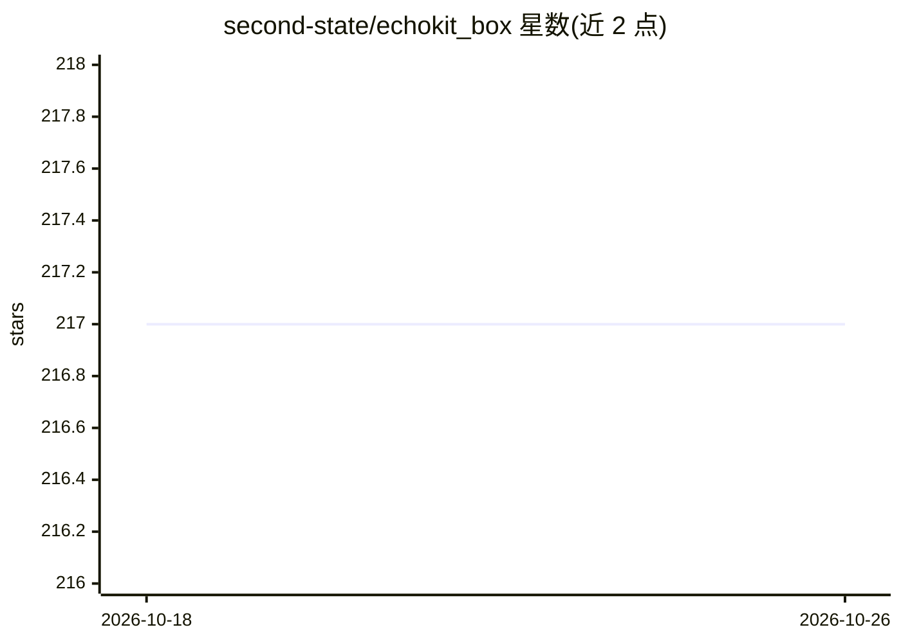

# second-state/echokit_box

⭐ 217 · Rust · GPL-3.0 · 推送 2026-05-05 · [GitHub](https://github.com/second-state/echokit_box) · [官网](https://echokit.dev/) · 组织维护

**EchoKit 语音设备的 ESP32 固件（Rust 编写）**

Second State 维护的 EchoKit 语音设备固件，面向 ESP32-S3（xtensa-esp32s3）硬件，用 Rust 编写，提供预编译二进制与源码构建两种方式，经 espflash 刷入。README 说明设备按键（RST 重启、K0 主操作）、USB 端口连接要求（需接 SLAVE/JTAG 串口），以及设备镜像的生成、重置与擦除流程。设备需连接并配置 EchoKit 服务器后才能完整使用。

## 筛选速览

| 维度 | 判定 | 备注 |
|---|---|---|
| AI 角色 | `ai-enhanced` | 去掉 AI 部分产品仍成立 |
| 许可风险 | `viral` | GPL-3.0 |
| 部署形态 | `library` | 以包/库形式分发 |
| 模型依赖 | — | README 未给出锁定关系 |
| 硬件要求 | — | 无带数字的原话,不猜 |
| 安装摩擦 | `medium` | 含编译或系统依赖之一 |
| 成熟度 | — | 结构信号不足 |

## 能力要点

- 支持预编译二进制下载或 cargo 源码构建
- 提供 box 设备的替代固件（--features box）
- 覆盖刷写、镜像生成、重置、擦除的 espflash 命令流程

## 适用场景

- 为 EchoKit 开发板或 box 设备刷写固件
- 从 Rust 源码构建自定义固件
- 排查设备刷写与串口连接问题

## 场景标签

 · 领域:嵌入式/语音硬件

## 证据(README 行号)

> L3: Firmware for the EchoKit device.
> L101: You will need to configure and start up an EchoKit server, and then configure your device to connect to the server

## 星数曲线

2026-10-18 217 → 2026-10-26 217（+0）

---
*卡片 v1 · prompt 1.4 · 生成 2026-10-22 · 置信度 mid · 依据 README sha `4d037cd0271b` · [字段定义](../../DATASET.md)*
