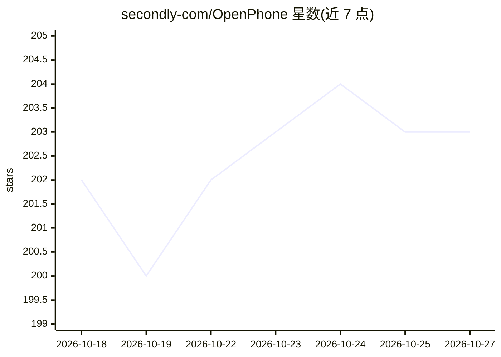

# secondly-com/OpenPhone

⭐ 203 · Java · NOASSERTION · 推送 2026-08-18 · [GitHub](https://github.com/secondly-com/OpenPhone) · [官网](https://openphone.secondly.com/) · 组织维护

**AI 原生 Android 操作系统：系统级 agent 操作手机**

基于 LineageOS 23.2 / Android 16 的 Android 覆盖层项目，将手机构建为 agentic 设备：以特权系统组件形式安装的 AI agent，可读取屏幕、UI 层级、通知、日历、位置等手机上下文，跨应用执行操作，支持心跳检查、定时任务、监视器与后台运行，敏感操作需用户审核，行为可通过审计日志与轨迹检视。首个物理设备目标为 Google Pixel 9a（tegu），通过脚本从源码构建模拟器镜像或刷机。非商业用途采用 PolyForm Noncommercial 许可，商业使用需另行书面授权。

## 筛选速览

| 维度 | 判定 | 备注 |
|---|---|---|
| AI 角色 | `ai-native` | 本体是模型或模型工具 |
| 许可风险 | `none` | NOASSERTION |
| 部署形态 | `None` |  |
| 模型依赖 | — | README 未给出锁定关系 |
| 硬件要求 | — | 无带数字的原话,不猜 |
| 安装摩擦 | `low` | 无编译、无系统依赖或容器化 |
| 成熟度 | `idea` | |

## 能力要点

- 特权系统级 agent：读屏、跨应用操作、承诺记忆与后台运行
- 敏感操作可审核，行为可经审计日志/轨迹/截图检视
- 支持心跳、定时任务、监视器等主动工作机制
- 基于 LineageOS 23.2 / Android 16，首个目标设备 Pixel 9a（tegu）

## 适用场景

- 让手机 agent 代订网约车、播放音乐等跨应用操作
- 设置监视野电话/配送通知并自动回复
- 把对话中的承诺转为可按情境重现的提醒

## 场景标签

`GUI 自动化` · 领域:效率与自动化

## 证据(README 行号)

> L15: OpenPhone is an AI-native Android OS that turns the phone into an agentic
> L27: OpenPhone is built around a system-level agent, not a chatbot app. The agent is
> L49: The current developer preview is based on LineageOS 23.2 / Android 16 and

## 星数曲线

2026-10-18 202 → 2026-10-27 203（+1）

---
*卡片 v1 · prompt 1.4 · 生成 2026-10-22 · 置信度 high · 依据 README sha `2b3f9764356b` · [字段定义](../../DATASET.md)*
