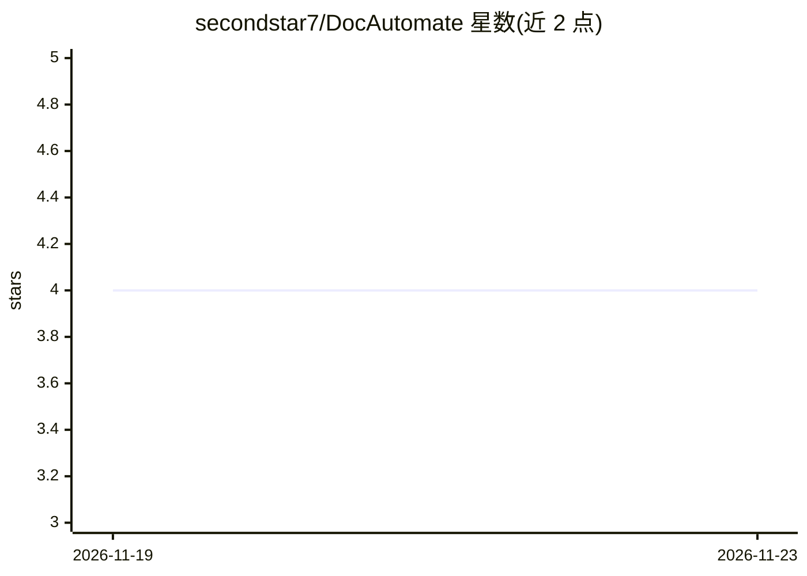

# secondstar7/DocAutomate

⭐ 4 · Python · 推送 2026-10-30 · [GitHub](https://github.com/secondstar7/DocAutomate) · 个人维护

**将文档处理委托给 Claude Code 的文档工作流自动化框架**

以委托为先的文档处理框架：业务逻辑放在 Claude Code 代理的提示词中，FastAPI 负责编排、存储与工作流控制。支持 PDF、DOCX、文本/Markdown、图片、表格与邮件摄取，默认全部处理委托给 Claude；本地回退（PyPDF2/docx2pdf）需显式开启环境变量。提供 REST API、tkinter 桌面 GUI、SQLite 持久化、19 个 YAML DSL 定义的工作流，以及 GPT-5 + Claude Opus 多模型共识投票机制。未配置 Claude 凭据时 CLI 返回模拟响应，仅限本地开发。

## 筛选速览

| 维度 | 判定 | 备注 |
|---|---|---|
| AI 角色 | `ai-native` | 本体是模型或模型工具 |
| 许可风险 | `none` | — |
| 部署形态 | `self-host` | docker 或自建部署 |
| 模型依赖 | locked-api |  |
| 硬件要求 | — | 无带数字的原话,不猜 |
| 安装摩擦 | `low` | 无编译、无系统依赖或容器化 |
| 成熟度 | — | 结构信号不足 |

## 能力要点

- 委托式架构：文档处理逻辑全部由 Claude Code 代理执行，FastAPI 仅做编排与存储
- YAML DSL 配置系统：新增文档类型仅需添加 YAML 配置，无需改代码
- 多模型共识投票（GPT-5 + Claude Opus）与委派/回退状态元数据透出
- 内置 FastAPI 后端、tkinter 桌面 GUI、SQLite 持久化与准确率基准脚本

## 适用场景

- 批量摄取并提取 PDF、图片、表格、邮件等文档中的字段
- 用 YAML 定义并执行文档审查、校验、修复等工作流
- 医疗记录等场景下构建符合 HIPAA 技术保障要求的处理流程

## 场景标签

`工作流自动化` `文档解析` · 领域:效率与自动化

## 证据(README 行号)

> L12: DocAutomate is a **delegation-first document processing framework** that keeps business logic in Claude Code agents
> L16: - Claude-driven ingestion for PDFs, images, plain text/Markdown, and DOCX (other formats require roadmap work).
> L35: - ✅ Images (Claude multimodal extraction)

## 星数曲线

2026-11-19 4 → 2026-11-23 4（+0）

---
*卡片 v1 · prompt 1.4 · 生成 2026-11-21 · 置信度 mid · 依据 README sha `1b07bc9c603e` · [字段定义](../../DATASET.md)*
