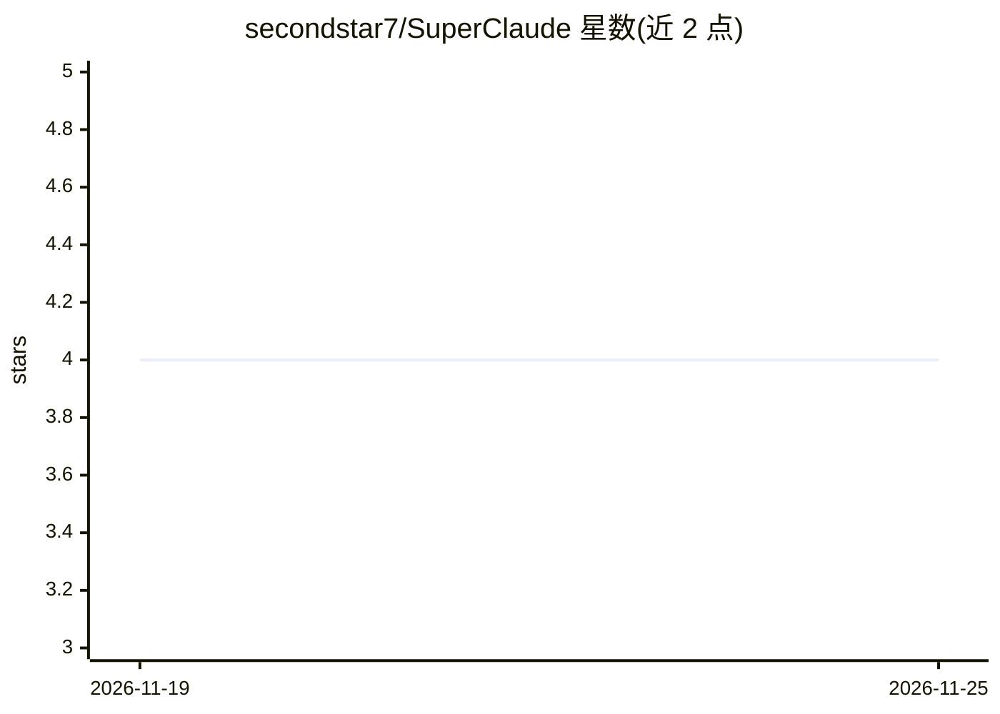

# secondstar7/SuperClaude

⭐ — · [GitHub]() · 个人维护

**为开发者扩展 Claude Code 的命令、persona 与工作流配置框架**

面向 Claude Code 用户的配置优先元框架：提供 19 个分层 agent persona（5 核心 + 7 特质 + 7 领域扩展）、27 个结构化命令、43 个技能与 6 种框架模式。核心接口为 Markdown/YAML 配置文件，另有约 2,800 行 Python 编排层，实现质量门迭代循环、终止检测、PAL MCP 集成与技能学习。可选集成 Sondera 安全层（依赖 Rust 工具链与 Ollama 模型，仅 Linux/macOS），安装方式为 git clone 或子模块，桌面 Dashboard 可视化执行状态。

## 筛选速览

| 维度 | 判定 | 备注 |
|---|---|---|
| AI 角色 | `ai-ecosystem` | LLM/agent 周边工具 |
| 许可风险 | `permissive` | — |
| 部署形态 | `desktop` | 安装包/桌面程序 |
| 模型依赖 | local-ok | 支持本地模型 |
| 硬件要求 | — | 无带数字的原话,不猜 |
| 安装摩擦 | `low` | 无编译、无系统依赖或容器化 |
| 成熟度 | — | 结构信号不足 |

## 能力要点

- 19 个分层 agent persona 与 27 个结构化命令（/sc:analyze、/sc:implement 等）
- Python 编排层：质量门迭代循环，评分 ≥70 或最多 5 次迭代后终止
- MCP 集成：PAL（11 工具）与 Rube（经 Composio 接入 500+ 应用）
- 可选 Sondera 安全层：LLM 意图分析与 Cedar 策略强制执行

## 适用场景

- 为 Claude Code 配置结构化命令与领域专家 persona
- 对实现任务运行带质量门的迭代改进循环
- 在生产部署中为 Claude Code 工具调用添加策略校验

## 场景标签

`编码 Agent` `Agent 框架` · 领域:Agent 开发

## 证据(README 行号)

> L13: **A config-first meta-framework for Claude Code that provides 19 specialized agent personas (5 core + 7 traits + 7 
> L15: SuperClaude transforms Claude Code into a powerful development platform with specialized agent prompts, signal-base
> L226: ## Installation

## 星数曲线

2026-11-19 4 → 2026-11-25 4（+0）

---
*卡片 v1 · prompt 1.4 · 生成 2026-11-21 · 置信度 high · 依据 README sha `40fb61c09194` · [字段定义](../../DATASET.md)*
