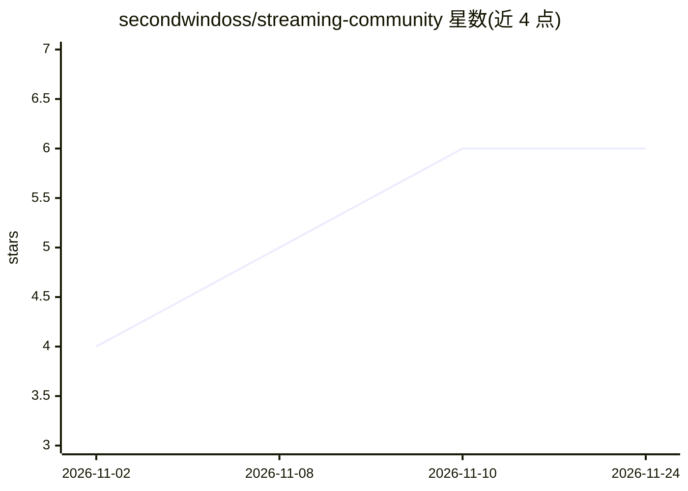

# secondwindoss/streaming-community

⭐ 6 · Python · Apache-2.0 · 推送 2026-11-13 · [GitHub](https://github.com/secondwindoss/streaming-community) · [官网](https://streaming-community.readthedocs.io/en/latest/) · 组织维护

**PyTorch 训练数据的云存储流式加载库**

社区维护的 MosaicML Streaming 分支，提供 PyTorch 的训练数据流式加载：数据以 MDS/JSON/CSV 分片存于云端，按需流式读取进 DataLoader。支持多数据流按比例混洗、跨 GPU/节点的确定性样本顺序、epoch 中途从检查点秒级恢复、缓存容量上限与 LRU 驱逐、随机访问未下载样本。开箱支持 S3/GCS/Azure/OCI/SFTP，Hugging Face、Databricks 等经可选 extra 启用。迁移时需先卸载上游包。

## 筛选速览

| 维度 | 判定 | 备注 |
|---|---|---|
| AI 角色 | `ai-ecosystem` | LLM/agent 周边工具 |
| 许可风险 | `permissive` | Apache-2.0 |
| 部署形态 | `library` | 以包/库形式分发 |
| 模型依赖 | — | README 未给出锁定关系 |
| 硬件要求 | — | 无带数字的原话,不猜 |
| 安装摩擦 | `low` | 无编译、无系统依赖或容器化 |
| 成熟度 | — | 结构信号不足 |

## 能力要点

- 同一 import 名称与 MDS 格式，0.13.0 数据集与检查点兼容读取
- 1 到 64 GPU 样本顺序确定性一致，支持 epoch 中途恢复
- cache_limit 磁盘预算与 LRU 分片驱逐
- S3/GCS/Azure/OCI/SFTP 开箱即用，hf/databricks/spark 等为可选 extra

## 适用场景

- 训练数据存放在云存储上的 PyTorch 分布式训练
- 多个数据集按比例混合采样训练
- 长时间训练任务需要中断后从检查点快速恢复
- 依赖 numpy 2.x / transformers 5 的环境中安装 streaming 库

## 场景标签

`模型训练` · 领域:训练与推理

## 证据(README 行号)

> L33:  Stream training data from cloud storage to every GPU: fast, deterministic and resumable.
> L78: Write samples as MDS shards, then stream them into a PyTorch `DataLoader`:
> L158: streaming-community is a community fork of MosaicML Streaming. The last upstream release, 0.13.0, was published on

## 星数曲线

2026-11-02 4 → 2026-11-24 6（+2）

---
*卡片 v1 · prompt 1.4 · 生成 2026-11-20 · 置信度 high · 依据 README sha `9be5cc194948` · [字段定义](../../DATASET.md)*
