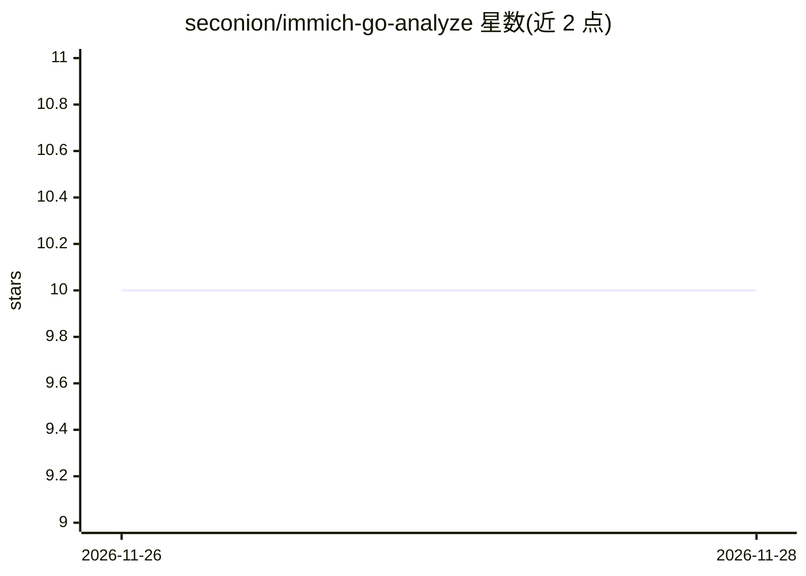

# seconion/immich-go-analyze

⭐ 10 · Go · 推送 2026-01-05 · [GitHub](https://github.com/seconion/immich-go-analyze) · [官网](https://github.com/seconion/immich-go-analyze) · 个人维护

**本地视觉模型为 Immich 照片自动生成描述与标签的 CLI 工具**

面向自托管 Immich 实例的 Go 语言 CLI 工具：调用本地 Ollama 视觉模型扫描图库，为缺少描述的图片批量生成包含物体、颜色、动作、场景等关键词的描述，填充到 Immich 元数据以改善站内搜索。以批处理（每批 100 张）、watcher 定时模式和模型基准测试（对比 minicpm-v/moondream/qwen3-vl 的速度与质量）三种方式运行；自动转换 WebP 缩略图以保证模型兼容。运行前提为可访问的 Ollama 与 Immich 的 Postgres 数据库端口。

## 筛选速览

| 维度 | 判定 | 备注 |
|---|---|---|
| AI 角色 | `ai-native` | 本体是模型或模型工具 |
| 许可风险 | `none` | — |
| 部署形态 | `desktop` | 安装包/桌面程序 |
| 模型依赖 | local-ok | 支持本地模型 |
| 硬件要求 | — | 无带数字的原话,不猜 |
| 安装摩擦 | `low` | 无编译、无系统依赖或容器化 |
| 成熟度 | — | 结构信号不足 |

## 能力要点

- 调用本地 Ollama 视觉模型批量生成照片描述与关键词
- 三种运行模式：批处理、watcher 定时监控、模型基准对比
- 自动转换 Immich WebP 缩略图以保证模型兼容
- 全程本地运行，数据不出本机网络

## 适用场景

- 为自托管 Immich 图库补全缺失的图片描述
- 让 Immich 站内搜索能按物体/场景/颜色检索照片
- 在本地局域网内定时增量处理新上传的照片
- 在多种视觉模型间对比挑选适合自己硬件的方案

## 场景标签

`图像视频处理` `模型评测` · 领域:评测与运维

## 证据(README 行号)

> L5: It uses local **Ollama** vision models (like `minicpm-v` or `moondream`) to automatically analyze your photos, gener
> L9: - **Automated AI Tagging:** Scans your library and fills in missing descriptions for thousands of images.
> L10: - **Smart Search Optimization:** Prompts the AI to generate keyword-rich descriptions (e.g., "birthday party", "sun

## 星数曲线

2026-11-26 10 → 2026-11-28 10（+0）

---
*卡片 v1 · prompt 1.4 · 生成 2026-11-26 · 置信度 mid · 依据 README sha `7beffa63cd85` · [字段定义](../../DATASET.md)*
