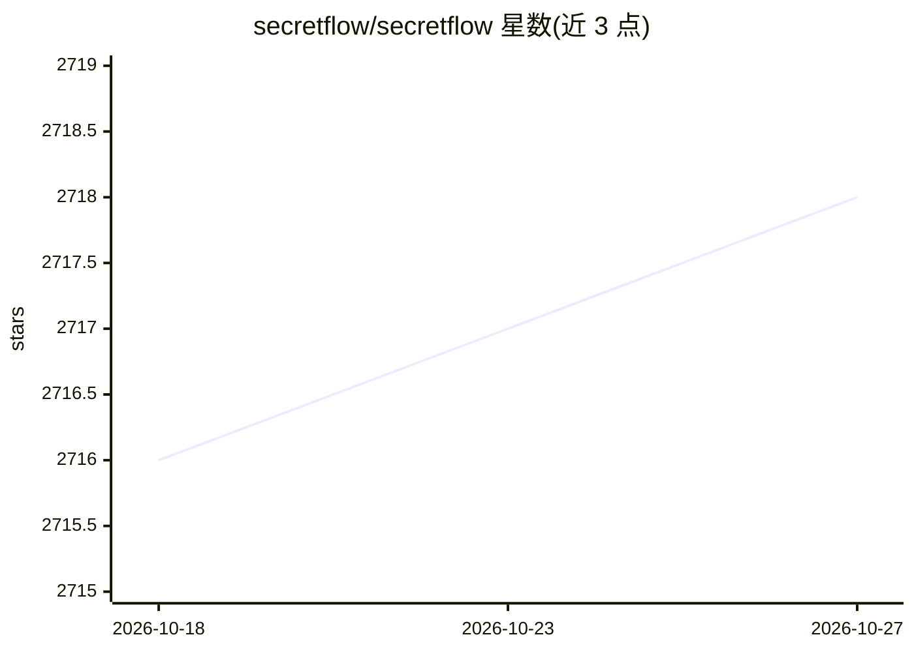

# secretflow/secretflow

⭐ 2,718 · Python · Apache-2.0 · 推送 2026-04-24 · [GitHub](https://github.com/secretflow/secretflow) · [官网](https://www.secretflow.org.cn/docs/secretflow/en/) · 组织维护 · 中文 README

**隐私保护数据分析与机器学习的统一框架**

SecretFlow 提供隐私保护数据智能与机器学习的统一框架，采用分层架构：抽象设备层封装明文设备与基于多种密码学协议的密文设备，设备流层将算法建模为设备对象流与 DAG，算法层支持横向/纵向切分数据的数据分析与机器学习，工作流层整合数据处理、模型训练与超参调优。面向需要多方联合建模而不泄露原始数据的开发与研究场景。安装与部署细节分别在 INSTALLATION.md 与 DEPLOYMENT.md 中给出。非正式发布版本被声明禁止用于生产环境。

## 筛选速览

| 维度 | 判定 | 备注 |
|---|---|---|
| AI 角色 | `ai-native` | 本体是模型或模型工具 |
| 许可风险 | `permissive` | Apache-2.0 |
| 部署形态 | `None` |  |
| 模型依赖 | — | README 未给出锁定关系 |
| 硬件要求 | — | 无带数字的原话,不猜 |
| 安装摩擦 | `low` | 无编译、无系统依赖或容器化 |
| 成熟度 | — | 结构信号不足 |

## 能力要点

- 分层架构：明文/密文设备层、设备流层、算法层、工作流层
- 支持横向与纵向切分数据的机器学习与数据分析
- 相关项目矩阵：Kuscia、SCQL、SPU、HEU、YACL
- 附隐私增强技术（PETs）论文与教程清单

## 适用场景

- 多方在不交换明文数据的前提下联合训练模型
- 对纵向切分数据做联合统计分析
- 构建整合数据处理与训练调优的隐私计算工作流

## 场景标签

`数据分析` · 领域:效率与自动化

## 证据(README 行号)

> L7: SecretFlow is a unified framework for privacy-preserving data intelligence and machine learning. To achieve this goa
> L12: - An algorithm layer to do data analysis and machine learning with horizontal or vertical partitioned data.

## 星数曲线

2026-10-18 2,716 → 2026-10-27 2,718（+2）

---
*卡片 v1 · prompt 1.4 · 生成 2026-10-21 · 置信度 mid · 依据 README sha `d6d69866c8d5` · [字段定义](../../DATASET.md)*
