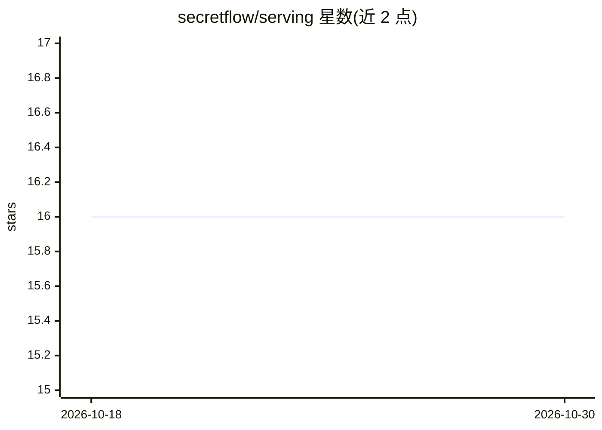

# secretflow/serving

⭐ 16 · C++ · Apache-2.0 · 推送 2026-10-28 · [GitHub](https://github.com/secretflow/serving) · [官网](https://www.secretflow.org.cn/en/docs/serving) · 组织维护

**面向隐私计算机器学习模型的隐私保护推理服务系统**

SecretFlow 生态的模型服务系统，用于部署和提供隐私保护机器学习模型的推理服务，支持多方安全计算场景下的模型 serving。通过 Docker 镜像（secretflow/serving-anolis8）分发与运行，README 给出拉取镜像并启动服务的基本流程，构建与测试说明见贡献指南。README 内容简短，具体支持的模型格式与协议细节需查阅文档。

## 筛选速览

| 维度 | 判定 | 备注 |
|---|---|---|
| AI 角色 | `ai-ecosystem` | LLM/agent 周边工具 |
| 许可风险 | `permissive` | Apache-2.0 |
| 部署形态 | `self-host` | docker 或自建部署 |
| 模型依赖 | — | README 未给出锁定关系 |
| 硬件要求 | — | 无带数字的原话,不猜 |
| 安装摩擦 | `low` | 无编译、无系统依赖或容器化 |
| 成熟度 | — | 结构信号不足 |

## 能力要点

- 提供隐私保护机器学习模型的服务化部署
- 以 Docker 镜像形式分发运行
- 属于 SecretFlow 隐私计算生态组件

## 适用场景

- 在多方协作场景下对外提供隐私保护模型推理服务
- 将训练好的隐私计算模型部署为生产服务

## 场景标签

`推理引擎` · 领域:训练与推理

## 证据(README 行号)

> L5: SecretFlow-Serving is a serving system for privacy-preserving machine learning models.
> L11: docker pull secretflow/serving-anolis8:latest

## 星数曲线

2026-10-18 16 → 2026-10-30 16（+0）

---
*卡片 v1 · prompt 1.4 · 生成 2026-10-30 · 置信度 high · 依据 README sha `2e44c28e4266` · [字段定义](../../DATASET.md)*
