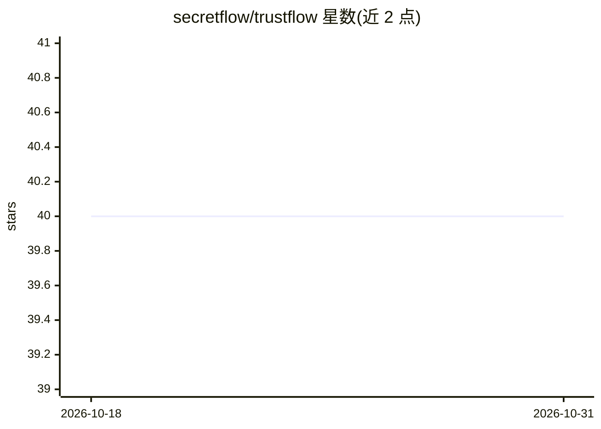

# secretflow/trustflow

⭐ 40 · C++ · Apache-2.0 · 推送 2026-03-12 · [GitHub](https://github.com/secretflow/trustflow) · [官网](https://www.secretflow.org.cn/docs/trustedflow) · 组织维护 · 中文 README

**基于 TEE 的零信任隐私计算系统，保护敏感数据存储与处理**

TrustFlow 是基于可信执行环境（TEE）的零信任计算系统，由 SecretFlow 团队维护。它通过远程认证、计算隔离、授权控制、审计机制与端到端加密，在隔离环境内保护敏感数据的机密性、完整性与可用性，并将数据访问权限限制到最低。功能覆盖数据预处理、经典机器学习、深度学习、大语言模型与数据分析，适用于敏感数据的安全存储、处理与共享场景。配套项目包括 CapsuleManager（授权与密钥管理）、TEEAPPs（可信应用）、CapsuleManagerSDK 与 TrustflowEnvoy。

## 筛选速览

| 维度 | 判定 | 备注 |
|---|---|---|
| AI 角色 | `ai-ecosystem` | LLM/agent 周边工具 |
| 许可风险 | `permissive` | Apache-2.0 |
| 部署形态 | `None` |  |
| 模型依赖 | — | README 未给出锁定关系 |
| 硬件要求 | — | 无带数字的原话,不猜 |
| 安装摩擦 | `low` | 无编译、无系统依赖或容器化 |
| 成熟度 | — | 结构信号不足 |

## 能力要点

- 基于 TEE 建立安全隔离的零信任计算环境
- 提供远程认证、计算隔离、授权控制与审计机制
- 支持数据预处理、机器学习、深度学习与大语言模型处理
- 配套 CapsuleManager/TEEAPPs 等相关项目组成体系

## 适用场景

- 在保密环境中存储和处理敏感数据
- 以最小权限方式对数据做机器学习与大模型计算
- 敏感数据的多方安全共享与处理

## 场景标签

 · 领域:隐私计算/机密计算

## 证据(README 行号)

> L5: **TrustFlow** is a zero-trust computing system based on TEE(Trusted Execution Environments). TrustFlow derives its n
> L11: In addition to its strong security features, TrustFlow offers a diverse array of data processing functionalities. T

## 星数曲线

2026-10-18 40 → 2026-10-31 40（+0）

---
*卡片 v1 · prompt 1.4 · 生成 2026-10-25 · 置信度 high · 依据 README sha `c25dfcc99a16` · [字段定义](../../DATASET.md)*
