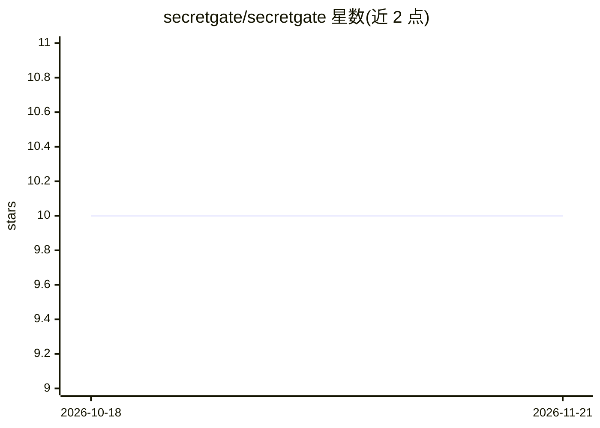

# secretgate/secretgate

⭐ 10 · Python · Apache-2.0 · 推送 2026-04-13 · [GitHub](https://github.com/secretgate/secretgate) · [官网](https://pypi.org/project/secretgate/) · 组织维护

**拦截 AI 编码工具外发流量并脱敏密钥的安全代理**

以本地代理形式包装 AI 编码工具：通过 https_proxy 或 secretgate wrap 命令，用 TLS MITM 截取所有外发 HTTPS 流量（含 git push 的 packfile），用正则扫描密钥并按 redact/block/audit 三种模式处理，检测到的密钥替换为确定性占位符并记录审计日志。可选 slirp4netns 网络命名空间隔离，在内核层封禁直连 443 端口。支持 Claude Code、Aider、Cursor、VS Code 等遵循标准代理环境变量的工具；SSH git remote、localhost 流量不经过代理。

## 筛选速览

| 维度 | 判定 | 备注 |
|---|---|---|
| AI 角色 | `ai-ecosystem` | LLM/agent 周边工具 |
| 许可风险 | `permissive` | Apache-2.0 |
| 部署形态 | `library` | 以包/库形式分发 |
| 模型依赖 | — | README 未给出锁定关系 |
| 硬件要求 | — | 无带数字的原话,不猜 |
| 安装摩擦 | `low` | 无编译、无系统依赖或容器化 |
| 成熟度 | — | 结构信号不足 |

## 能力要点

- TLS MITM 正向代理，扫描外发请求体并按 redact/block/audit 三模式处理
- 解析 git push 的二进制 packfile，检测提交/blob/tag 中的密钥
- 确定性占位符替换（REDACTED<slug:hash12>），同一密钥生成相同占位符
- 可选 slirp4netns 网络命名空间隔离，封禁绕过代理的直连 HTTPS

## 适用场景

- 让 Claude Code 等 AI 编码代理在本机使用时不外泄 API 密钥
- 拦截 git push 中误提交的 AWS 密钥等敏感信息
- 为内部网络域名配置 passthrough，跳过 MITM 检查

## 场景标签

`网络安全` · 领域:学习与行业

## 证据(README 行号)

> L12: **secretgate** makes AI-assisted development secure by default. One command wraps
> L34: 2. secretgate intercepts every outbound HTTPS request via TLS MITM and scans for secrets
> L178: `secretgate wrap` works with any tool that respects the standard `https_proxy`

## 星数曲线

2026-10-18 10 → 2026-11-21 10（+0）

---
*卡片 v1 · prompt 1.4 · 生成 2026-11-19 · 置信度 high · 依据 README sha `e963d2b8354c` · [字段定义](../../DATASET.md)*
