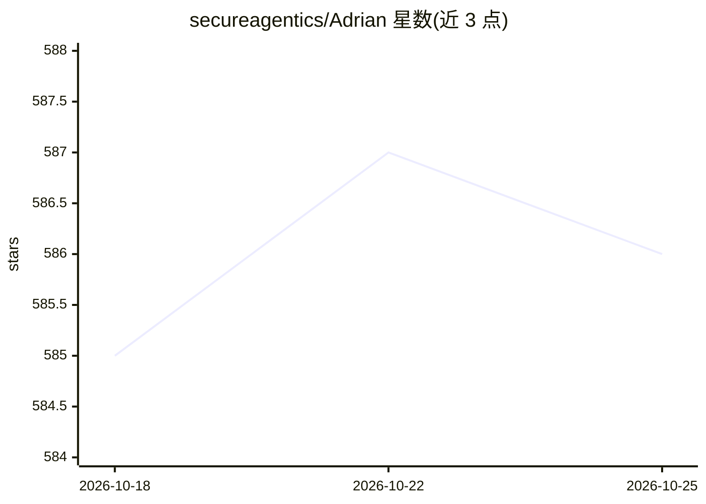

# secureagentics/Adrian

⭐ 586 · Python · Apache-2.0 · 推送 2026-10-21 · [GitHub](https://github.com/secureagentics/Adrian) · [官网](https://secureagentics.ai) · 组织维护

**AI agent 运行时安全监控引擎：检测并拦截恶意工具调用与提示注入**

面向 AI agent 的运行时安全监控与控制引擎（AARM 对齐）：通过 SDK 嵌入 agent 代码，分析活动日志（工具调用、动作、输出）与推理轨迹，检测提示注入、工具投毒、数据外泄与越权行为，支持审计或拦截模式及在飞行中干预。提供 Python/TypeScript SDK、Claude Code 插件与托管仪表盘；自托管需 Docker Compose、NVIDIA GPU 与 CUDA，捆绑 Llama.cpp 服务本地 Gemma 分类器，可完全离线部署。采用 Apache 2.0 许可。

## 筛选速览

| 维度 | 判定 | 备注 |
|---|---|---|
| AI 角色 | `ai-ecosystem` | LLM/agent 周边工具 |
| 许可风险 | `permissive` | Apache-2.0 |
| 部署形态 | `self-host` | docker 或自建部署 |
| 模型依赖 | local-ok | 支持本地模型 |
| 硬件要求 | — | 无带数字的原话,不猜 |
| 安装摩擦 | `low` | 无编译、无系统依赖或容器化 |
| 成熟度 | — | 结构信号不足 |

## 能力要点

- 结合行为日志与推理轨迹进行运行时检测，支持审计/拦截模式
- 检测提示注入、工具投毒、数据外泄与越权动作
- Python (LangChain/Anthropic) 与 TypeScript SDK，及 Claude Code 插件
- 自托管栈含 Go 后端、Next.js 仪表盘与 Llama.cpp 本地 Gemma 分类器，可完全离线

## 适用场景

- 在生产环境监控 agent 的工具调用并拦截高风险动作
- 对 coding agent 的提示注入与数据外泄做运行时防护
- 数据主权要求下完全离线自托管 agent 安全监控

## 场景标签

`网络安全` `LLM 可观测性` · 领域:评测与运维

## 证据(README 行号)

> L18: Adrian is an open-source, AARM-aligned runtime security monitoring and control engine for AI agents. It analyses bo
> L87: Adrian supports entirely offline, data sovereign deployments using just a handful of docker commands. This reposito

## 星数曲线

2026-10-18 585 → 2026-10-25 586（+1）

---
*卡片 v1 · prompt 1.4 · 生成 2026-10-21 · 置信度 high · 依据 README sha `5d03d8b60649` · [字段定义](../../DATASET.md)*
