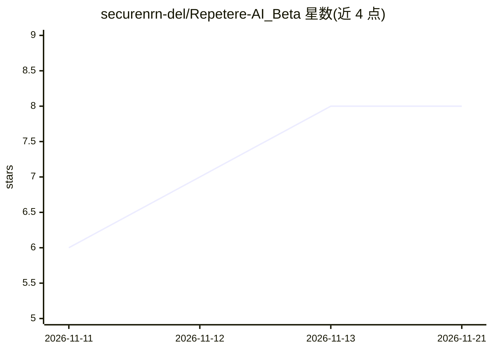

# securenrn-del/Repetere-AI_Beta

⭐ 8 · 推送 2026-10-27 · [GitHub](https://github.com/securenrn-del/Repetere-AI_Beta) · 个人维护

**本地多模态 AI 工作站：代码/对话/写作/音乐/图像五大工作区**

Windows 原生 C++ 桌面应用（GLFW + Dear ImGui + OpenGL 3，无 Electron/Python/Chromium），通过 CUDA 12 与 Vulkan 1.3 双后端在本地 GPU/APU 上运行 GGUF 权重模型。提供五个工作区：Qwen 2.5 Coder 代码 IDE（SEARCH/REPLACE AST diff）、Llama 3.1 8B 聊天、Hermes 3 长篇写作、YuE2 音乐合成、FLUX.1 Schnell/SDXL 文生图。支持 GPU 与 HYBRID 混合显存/内存分层模式，全部推理离线执行。安装包未签名，1.0 版提供付费永久许可。

## 筛选速览

| 维度 | 判定 | 备注 |
|---|---|---|
| AI 角色 | `ai-native` | 本体是模型或模型工具 |
| 许可风险 | `none` | — |
| 部署形态 | `desktop` | 安装包/桌面程序 |
| 模型依赖 | local-ok | 支持本地模型 |
| 硬件要求 | `gpu-8g` | |
| 安装摩擦 | `medium` | 含编译或系统依赖之一 |
| 成熟度 | `idea` | |

## 能力要点

- CUDA 12 + Vulkan 1.3 双后端运行时热切换与混合层卸载（-ngl）
- 五个本地工作区：代码 IDE、聊天、长篇写作、歌曲合成、文生图
- 全部推理 100% 离线本地执行，无云端遥测
- HYBRID 模式支持 8–12 GB VRAM 显卡运行 14B/32B 模型

## 适用场景

- 在无网络的本地机器上运行多模态生成任务
- 用本地代码模型对源文件做 diff 补丁式修改
- 本地生成最长 6 分钟的人声与伴奏歌曲
- 用本地扩散模型做文生图并在内置画布后期调色

## 场景标签

`图像生成` `多模态` `聊天机器人` · 领域:对话与助手

## 证据(README 行号)

> L32: **Repetere AI** is a decentralized, self-hosted Artificial Intelligence ecosystem engineered to restore computing s
> L65:  * 💻 CODING (Interactive IDE): Interactive split-view programming studio powered by Qwen 2.5 Coder checkpoints (7B,
> L69:  * 🎨 IMAGES (Diffusion & Photoshop Studio): Text-to-image and image-to-image canvas powered by FLUX.1 Schnell and S

## 星数曲线

2026-11-11 6 → 2026-11-21 8（+2）

---
*卡片 v1 · prompt 1.4 · 生成 2026-11-20 · 置信度 high · 依据 README sha `14597b22c55e` · [字段定义](../../DATASET.md)*
