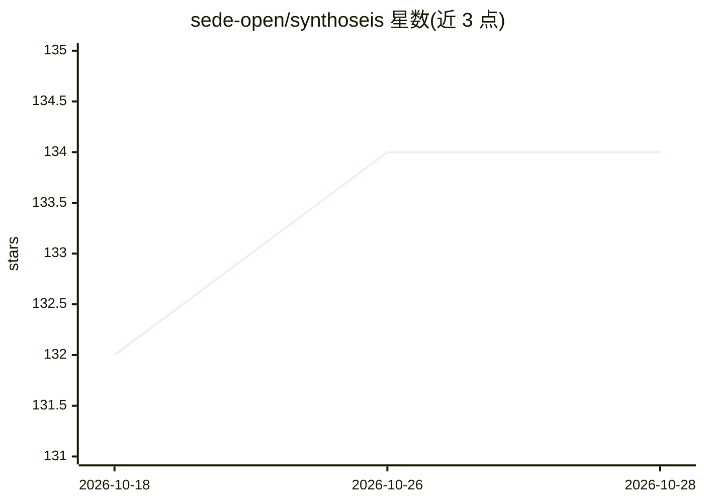

# sede-open/synthoseis

⭐ 134 · Python · MIT · 推送 2026-10-24 · [GitHub](https://github.com/sede-open/synthoseis) · 组织维护

**为深度学习生成带标签的合成地震训练数据的 Python 工具**

开源 Python 工具，用于生成伪随机的合成地震数据及配套标签，目标是训练深度学习网络识别野外采集地震数据中的目标特征。工作流为：从配置文件读参数，随机沉积地层、选取相带、注入断层/盐体/盆底扇等构造，经岩石物理模型与带通滤波生成角度道集地震数据。提供 conda 环境（需 Python 3.10+）、命令行运行及 FastAPI+React 交互式仪表盘（需 uv 与 Node.js）。岩石物理模型可通过模板脚本扩展。

## 筛选速览

| 维度 | 判定 | 备注 |
|---|---|---|
| AI 角色 | `ai-ecosystem` | LLM/agent 周边工具 |
| 许可风险 | `permissive` | MIT |
| 部署形态 | `None` |  |
| 模型依赖 | — | README 未给出锁定关系 |
| 硬件要求 | — | 无带数字的原话,不猜 |
| 安装摩擦 | `low` | 无编译、无系统依赖或容器化 |
| 成熟度 | — | 结构信号不足 |

## 能力要点

- 伪随机生成地层、断层、盐体、盆底扇等多样地下场景
- 同时输出地震数据与质量训练标签
- 交互式 Web 仪表盘配置、启动与监控生成任务
- 岩石物理模型可按 rpm_example.py 模板自定义扩展

## 适用场景

- 为地震解释网络生成大量带标签的训练数据
- 通过仪表盘交互式配置并监控数据生成批次
- 探索不同构造样式（断层/盐体/圈闭）的合成地震样例

## 场景标签

 · 领域:地球物理/地震勘探

## 证据(README 行号)

> L5: Generating seismic data and associated labels to train deep learning networks.
> L11: The goal of synthoseis is to generate realistic seismic data for training a deep learning network to identify featu

## 星数曲线

2026-10-18 132 → 2026-10-28 134（+2）

---
*卡片 v1 · prompt 1.4 · 生成 2026-10-22 · 置信度 high · 依据 README sha `8a4ecf122581` · [字段定义](../../DATASET.md)*
