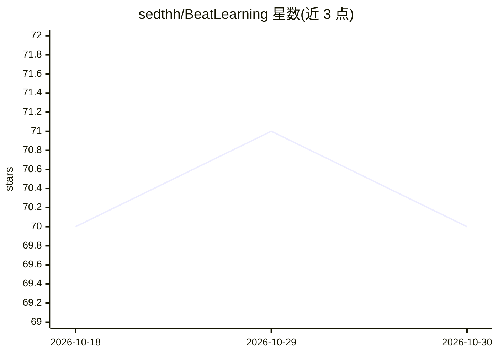

# sedthh/BeatLearning

⭐ 70 · Python · Apache-2.0 · 推送 2026-01-18 · [GitHub](https://github.com/sedthh/BeatLearning) · 个人维护

**为节奏游戏（当前仅 OSU）自动生成谱面的开源生成模型研究项目**

研究项目，提供基于掩码编码器（BEaRT/Bertsune Miku）的谱面自动生成模型：谱面转为中间格式并按 100ms 切块 token 化，配合 Mel 频谱音频切片训练，通过回归估计 BPM 与 hearing loss 预测掩码 token，从左到右生成谱面。当前仅支持 OSU 谱图且仅支持简单 HIT 物体、不含滑条；仓库自称 WORK IN PROGRESS，模型托管于 HuggingFace，通过 Python 虚拟环境 + requirements.txt + Jupyter Notebook 使用，另有 Google Colab 版本（CPU 推理耗时较长）。

## 筛选速览

| 维度 | 判定 | 备注 |
|---|---|---|
| AI 角色 | `ai-native` | 本体是模型或模型工具 |
| 许可风险 | `permissive` | Apache-2.0 |
| 部署形态 | `library` | 以包/库形式分发 |
| 模型依赖 | — | README 未给出锁定关系 |
| 硬件要求 | — | 无带数字的原话,不猜 |
| 安装摩擦 | `low` | 无编译、无系统依赖或容器化 |
| 成熟度 | `idea` | |

## 能力要点

- BEaRT 掩码编码器：BPM 回归 + hearing loss 掩码 token 预测
- 谱图按 100ms 切块 token 化，10ms 精度量化，词表预计算
- 支持 1/2/4 轨道谱面生成，当前仅限 OSU 格式
- 模型托管于 HuggingFace，提供 Jupyter Notebook 与 Google Colab 使用方式

## 适用场景

- 把无谱面的歌曲自动生成 OSU 谱面来游玩
- 谱面作者借助 AI 辅助快速产出新谱
- 小型节奏游戏开发者为自己的游戏批量生成内容

## 场景标签

 · 领域:游戏/生成式 AI

## 证据(README 行号)

> L6: This Open Source research project aims to democratize the process of automatic beatmap creation, offering accessible
> L59: These tokens, along with slices of the audio data (its projected Mel Spectogram aligned with the tokens), serve as 

## 星数曲线

2026-10-18 70 → 2026-10-30 70（+0）

---
*卡片 v1 · prompt 1.4 · 生成 2026-10-24 · 置信度 mid · 依据 README sha `f2077813a777` · [字段定义](../../DATASET.md)*
