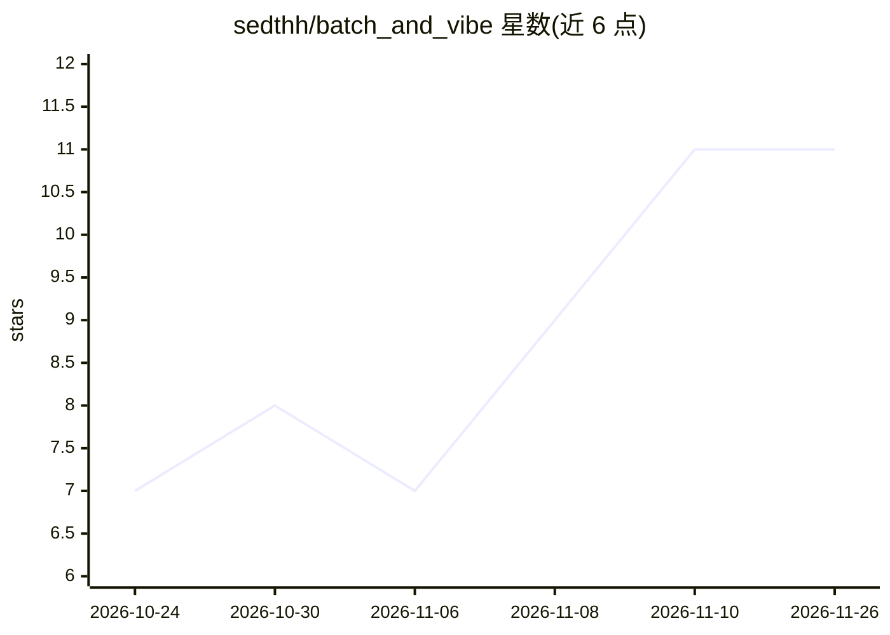

# sedthh/batch_and_vibe

⭐ 11 · Python · MIT · 推送 2026-11-04 · [GitHub](https://github.com/sedthh/batch_and_vibe) · 个人维护

**让 LLM 接管《黑与白》游戏生物对话与行为的模组**

面向 2001 年游戏《Black & White》的 Windows 模组：将 LLM 接入生物的思维与行动，玩家可与其对话、下达指令、听取其想法，同时保留游戏原有生物 AI 与奖惩学习机制。设置中可选多种 API 提供商与本地模型，支持语音输入（F11 按键说话）、生物语音回复（Windows 离线语音/本地 Piper/语音 API）、Winamp 音乐联动与 BW1-VR 启动。依赖游戏本体、补丁序列（1.10→1.20→1.42）与 Python 3.11+，通过仓库内 cmd 脚本安装与启动。

## 筛选速览

| 维度 | 判定 | 备注 |
|---|---|---|
| AI 角色 | `ai-enhanced` | 去掉 AI 部分产品仍成立 |
| 许可风险 | `permissive` | MIT |
| 部署形态 | `None` |  |
| 模型依赖 | — | README 未给出锁定关系 |
| 硬件要求 | — | 无带数字的原话,不猜 |
| 安装摩擦 | `low` | 无编译、无系统依赖或容器化 |
| 成熟度 | — | 结构信号不足 |

## 能力要点

- LLM 对话与指令控制游戏生物，同时保留原版 AI 与奖惩学习
- 可选 API 提供商或本地 LLM 服务器，支持工具调用与结构化回复
- 语音输入（F11）与生物语音回复，含本地离线 Piper 模型选项
- 支持 BW1-VR 启动与远程 API 用量上限设置

## 适用场景

- 与游戏中的生物对话并让它执行指令如搬木头、浇树
- 用本地模型离线运行避免 API 费用
- 在 VR 中以语音与生物互动

## 场景标签

`聊天机器人` `语音 Agent` · 领域:对话与助手

## 证据(README 行号)

> L4: plans together. This mod uses LLMs to add conversation,
> L6: (2001), while **keeping the original creature AI** active alongside them. Your

## 星数曲线

2026-10-24 7 → 2026-11-26 11（+4）

---
*卡片 v1 · prompt 1.4 · 生成 2026-11-18 · 置信度 high · 依据 README sha `576c31494a26` · [字段定义](../../DATASET.md)*
