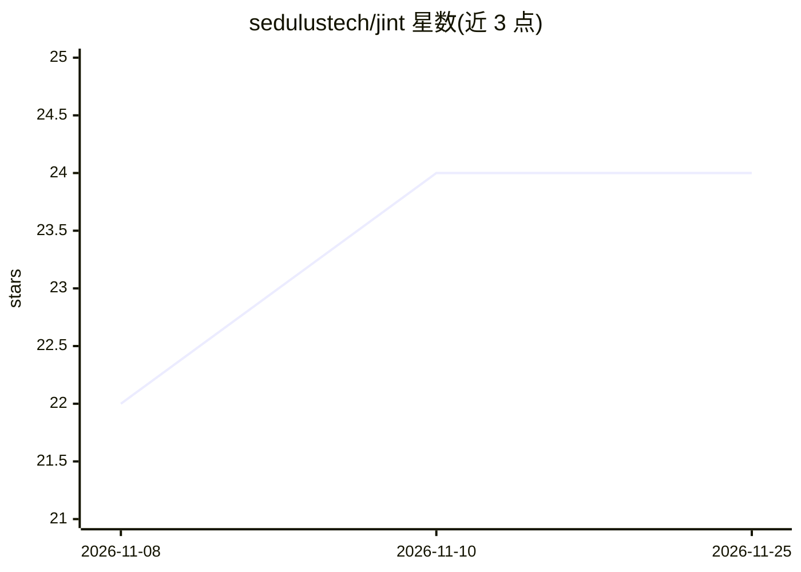

# sedulustech/jint

⭐ 24 · TypeScript · MIT · 推送 2026-11-23 · [GitHub](https://github.com/sedulustech/jint) · [官网](https://jint.sh) · 组织维护

**面向开发者的语义化代码 linter：用 AI 分类器执行自定义规则**

jint 用 Treesitter 从源码构造文件/函数/类等词法单元，再通过 Typesafe 的 Jev 分类器按用户自定义规则打分，经 per-rule 回调与 handle 生成 error/warn 级别的 lint 输出与修复指引。以 NPM 包或安装脚本分发，二进制内置 Bun 运行时，无需本地 JS 运行时。支持自带 tree-sitter 语法接入任意语言、jint serve 本地看板校准规则，并为 agent 提供 jint-follow/jint-author 技能。当前 Jev 是唯一支持的分类器，需 TYPESAFE_API_KEY。

## 筛选速览

| 维度 | 判定 | 备注 |
|---|---|---|
| AI 角色 | `ai-native` | 本体是模型或模型工具 |
| 许可风险 | `permissive` | MIT |
| 部署形态 | `library` | 以包/库形式分发 |
| 模型依赖 | — | README 未给出锁定关系 |
| 硬件要求 | — | 无带数字的原话,不猜 |
| 安装摩擦 | `low` | 无编译、无系统依赖或容器化 |
| 成熟度 | — | 结构信号不足 |

## 能力要点

- Treesitter 构造状态 + Jev 分类器按规则分类，生成可操作的 lint 结论
- 多种 target（files/functions/classes/comments 等）与自带语法扩展到任意语言
- 二进制内置 Bun 运行时，Linux 上仅要求 glibc
- jint serve 本地看板展示 token 用量、耗时与按规则分组的结果

## 适用场景

- 在 CI 中对代码做基于语义规则的质量检查
- 团队自定义 lint 规则并按严重度与修复指引输出
- 为 agent 提供运行 linter 并修复发现的技能

## 场景标签

`代码审查` · 领域:编码与开发

## 证据(README 行号)

> L5: `jint` constructs state with Treesitter, and classifies the state against a set of user defined rules using Typesafe

## 星数曲线

2026-11-08 22 → 2026-11-25 24（+2）

---
*卡片 v1 · prompt 1.4 · 生成 2026-11-18 · 置信度 mid · 依据 README sha `0e9622a87f63` · [字段定义](../../DATASET.md)*
