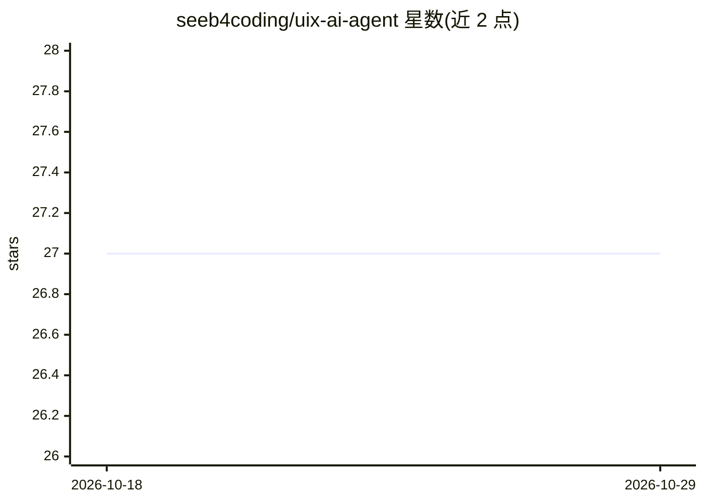

# seeb4coding/uix-ai-agent

⭐ 27 · TypeScript · MIT · 推送 2026-01-02 · [GitHub](https://github.com/seeb4coding/uix-ai-agent) · [官网](https://seeb4coding.in/) · 个人维护

**面向开发者与设计师的浏览器端 AI 界面设计生成器**

基于 React 18 + TypeScript + Tailwind + React Flow 构建的 Web 应用：用户输入自然语言提示（如 fintech 仪表盘、外卖 App 流程），经 Google Gemini 3.0 模型生成结构化 UI 定义，再以可视化方式渲染屏幕、设计系统与页面流程。应用完全在浏览器客户端运行，无后端存储，用户需自带 Google Gemini API Key（通过 .env 配置）。通过 git clone + npm install + npm run dev 本地运行，提供在线 Demo。

## 筛选速览

| 维度 | 判定 | 备注 |
|---|---|---|
| AI 角色 | `ai-native` | 本体是模型或模型工具 |
| 许可风险 | `permissive` | MIT |
| 部署形态 | `library` | 以包/库形式分发 |
| 模型依赖 | — | README 未给出锁定关系 |
| 硬件要求 | — | 无带数字的原话,不猜 |
| 安装摩擦 | `low` | 无编译、无系统依赖或容器化 |
| 成熟度 | — | 结构信号不足 |

## 能力要点

- 自然语言生成 Web/移动端 UI/UX 流程
- 自动创建设计系统并可视化屏幕流程（React Flow）
- 完全在浏览器端运行，无需后端
- 自带 Gemini API Key，密钥不存储于服务器

## 适用场景

- 用自然语言快速生成应用界面原型
- 为 Web/移动应用生成设计系统与页面流程图
- 本地运行一个无后端的 AI 设计助手

## 场景标签

`代码生成` · 领域:编码与开发

## 证据(README 行号)

> L10: UIX AI Agent is an intelligent design agent that helps you generate complete **UI & UX flows** for web and mobile a
> L114: 2. UIX AI Agent sends structured instructions to Gemini via Google AI Studio
> L36: - ⚡ Runs entirely in the browser

## 星数曲线

2026-10-18 27 → 2026-10-29 27（+0）

---
*卡片 v1 · prompt 1.4 · 生成 2026-10-26 · 置信度 high · 依据 README sha `83e178c6fa51` · [字段定义](../../DATASET.md)*
