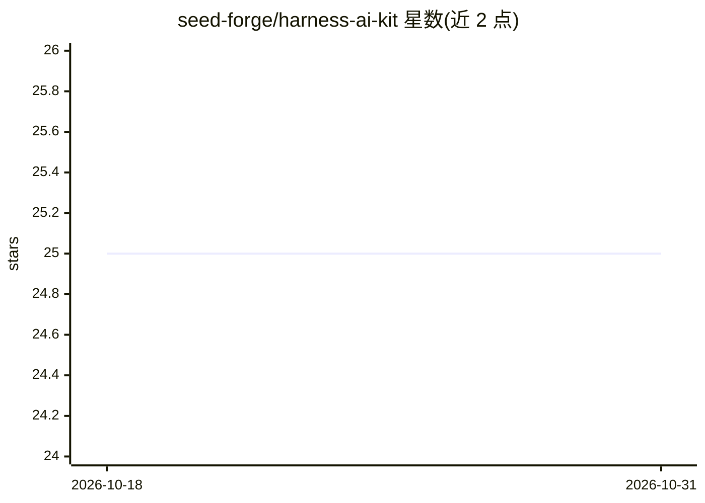

# seed-forge/harness-ai-kit

⭐ 25 · Python · Apache-2.0 · 推送 2026-08-31 · [GitHub](https://github.com/seed-forge/harness-ai-kit) · [官网](https://pypi.org/project/harness-ai-kit/) · 组织维护 · 中文 README

**AI agent 资产的包管理器：跨运行时可复现安装技能与工具**

面向 AI 工程团队的资产组合层：以项目清单（manifest）为唯一事实源，对 Skills、CLIs、MCP、插件、hooks、subagents 等资产做安装、依赖解析、锁定（含 SHA-256 校验和）与运行时物化，适配 Codex、Claude Code、Cursor、Kiro、DeepSeek Harness (dsh) 等编码运行时。安装经 staging 目录校验后替换，支持回滚；团队通过提交清单与 lockfile 共享同一资产基线。采用 REMIX 方法优先复用社区既有资产而非重建。需 Python 3.10+ 与 Git，Apache-2.0 许可。

## 筛选速览

| 维度 | 判定 | 备注 |
|---|---|---|
| AI 角色 | `ai-ecosystem` | LLM/agent 周边工具 |
| 许可风险 | `permissive` | Apache-2.0 |
| 部署形态 | `library` | 以包/库形式分发 |
| 模型依赖 | — | README 未给出锁定关系 |
| 硬件要求 | — | 无带数字的原话,不猜 |
| 安装摩擦 | `low` | 无编译、无系统依赖或容器化 |
| 成熟度 | — | 结构信号不足 |

## 能力要点

- 以 manifest→lockfile→运行时物化的可复现资产管线
- 统一类型化资产模型覆盖 Skills/CLIs/MCPs/hooks/subagents/loops
- 多运行时适配器支持 Codex、Claude Code、Cursor、Kiro、dsh
- 带校验与回滚的分阶段安全安装流程

## 适用场景

- 团队统一管理 AI 编码运行时的技能与工具资产版本
- 将清单和 lockfile 提交版本库，让成员获得相同资产基线
- 从公开 Git 仓库安装经审查的 Skill 并同步到项目运行时

## 场景标签

 · 领域:AI 工程工具链/包管理

## 证据(README 行号)

> L10: `harness-ai-kit` installs, resolves, locks, validates, and synchronizes Skills,
> L11: CLIs, MCPs, plugins, hooks, subagents, and loops across Codex, Claude Code,
> L26: harness-ai-kit.yml  ->  resolve  ->  harness-ai-kit.lock  ->  runtime materialization

## 星数曲线

2026-10-18 25 → 2026-10-31 25（+0）

---
*卡片 v1 · prompt 1.4 · 生成 2026-10-26 · 置信度 high · 依据 README sha `57e97bcbf34b` · [字段定义](../../DATASET.md)*
