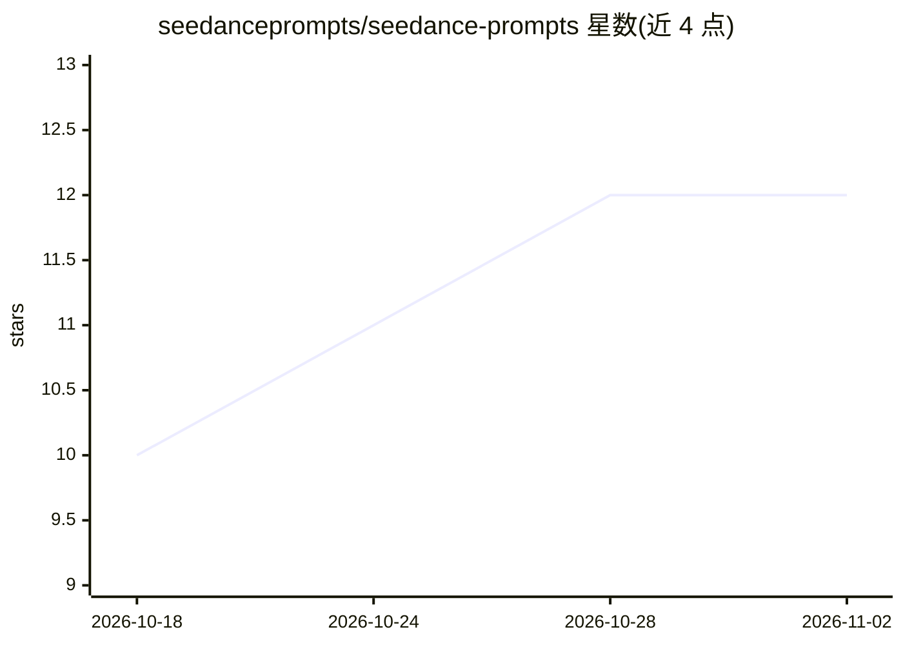

# seedanceprompts/seedance-prompts

⭐ 12 · CC-BY-4.0 · 推送 2026-02-24 · [GitHub](https://github.com/seedanceprompts/seedance-prompts) · 个人维护 · 中文 README

**Seedance 2.0 提示词资源策展清单：仓库、画廊、工具与创作者**

面向 Seedance 2.0 文生/图生视频用户的资源聚合清单：收录官方平台（即梦、SEED、剪映、豆包等）、GitHub 提示词仓库、带视频预览的提示词网站、提示词工程指南、第三方 API 工具（Volcano/Replicate/fal.ai 等）及 X 上 50+ 位创作者，按类别组织并接受 PR 贡献。不含模型本身或安装步骤，仅提供条目链接与描述，采用 CC BY 4.0 许可。

## 筛选速览

| 维度 | 判定 | 备注 |
|---|---|---|
| AI 角色 | `ai-knowledge` | 知识聚合/清单类 |
| 许可风险 | `viral` | CC-BY-4.0 |
| 部署形态 | `None` |  |
| 模型依赖 | — | README 未给出锁定关系 |
| 硬件要求 | — | 无带数字的原话,不猜 |
| 安装摩擦 | `low` | 无编译、无系统依赖或容器化 |
| 成熟度 | — | 结构信号不足 |

## 能力要点

- 收录 8+ 个 Seedance 提示词 GitHub 仓库与 6 个带视频预览的提示词网站
- 提供提示词工程速览技巧（时间码、镜头语言、风格引用、时长约束）
- 按 6 类风格整理 X 平台创作者列表，总计 50+ 位
- 列出官方平台与第三方 API 渠道

## 适用场景

- 查找 Seedance 2.0 可复用的提示词模板与示例视频
- 学习文生视频提示词的写法与镜头控制技巧
- 发现可关注提示词分享的创作者与社区

## 场景标签

`精选清单` `提示工程` · 领域:Agent 开发

## 证据(README 行号)

> L7: > A collection of Seedance 2.0 prompt resources.
> L9: GitHub repos, online galleries, API tools, prompt guides, active creators. Updated regularly.

## 星数曲线

2026-10-18 10 → 2026-11-02 12（+2）

---
*卡片 v1 · prompt 1.4 · 生成 2026-11-01 · 置信度 high · 依据 README sha `3ae1428c4886` · [字段定义](../../DATASET.md)*
